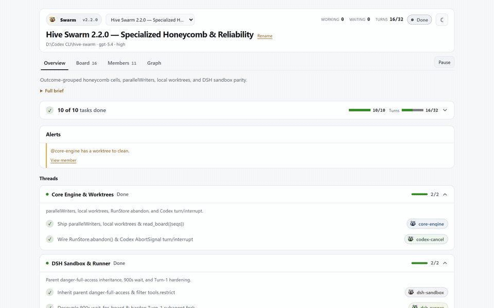
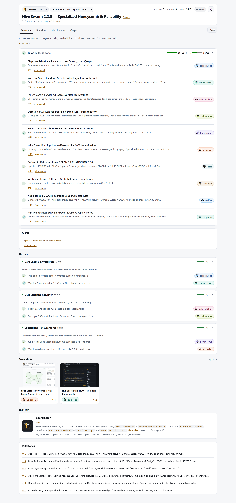
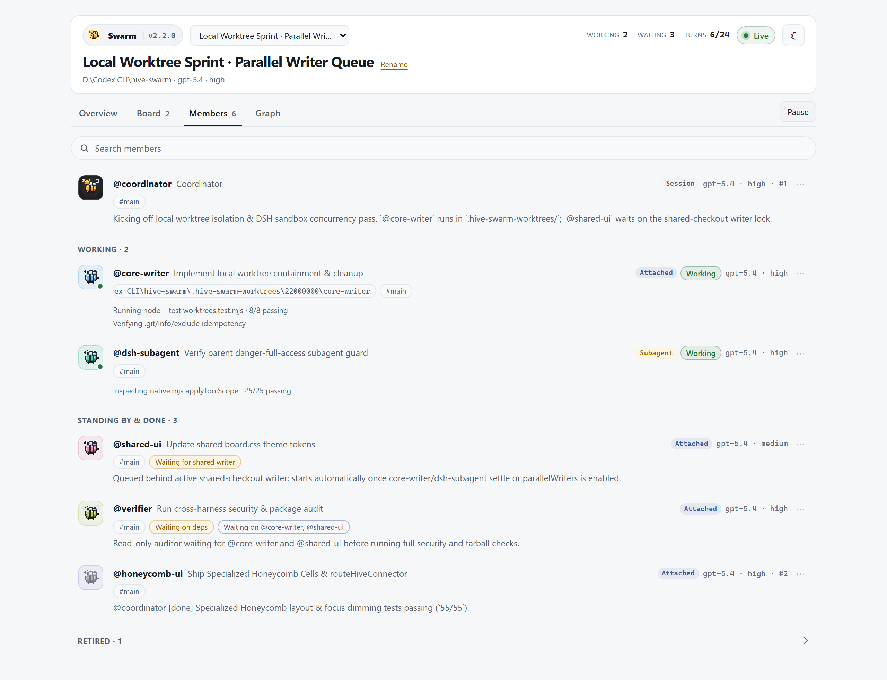
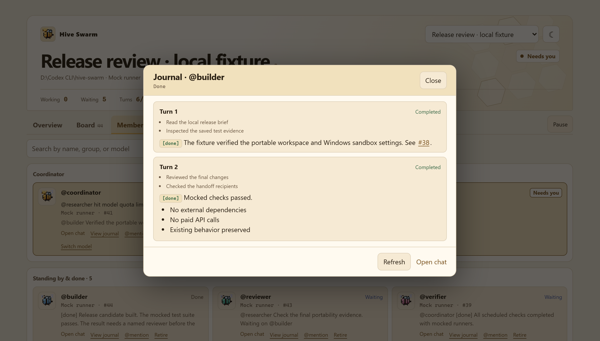

<div align="center">
  

  <p><strong>One goal. A team of agents. A shared board for every handoff.</strong></p>

  <p>
    <a href="https://github.com/snowmiku601-cpu/hive-swarm/actions/workflows/ci.yml"></a>
    <a href="https://github.com/snowmiku601-cpu/hive-swarm/releases/tag/v2.1.2"></a>
    <a href="https://www.npmjs.com/package/hive-swarm"></a>
    <a href="https://www.npmjs.com/package/dsh-hive-swarm"></a>
    
    
    <a href="./LICENSE"></a>
  </p>

  <p>
    <a href="#quick-start">🚀 Quick Start</a> ·
    <a href="#see-it-in-action">🖼️ See It in Action</a> ·
    <a href="#how-the-hive-moves-work">🧭 How It Works</a> ·
    <a href="#key-features">💡 Features</a> ·
    <a href="#usage">💬 Usage</a> ·
    <a href="#development-and-tests">✅ Tests</a> ·
    <a href="./CHANGELOG.md">📋 Changelog</a>
  </p>
</div>

---

Hive Swarm is a lightweight **multi-agent coordination engine and UI** for AI coding assistants. Split a goal across focused workers, let builders and verifiers hand work directly to each other on a shared board, track outcomes and live steps, and trace every result back to its handoff.

The coordination core (`engine.mjs`, `core.mjs`, `run-store.mjs`) is harness-agnostic:

- **Codex Desktop & Codex CLI (`hive-swarm@2.1.2`, npm `latest`)** — full MCP server, attached child threads on Codex `0.171+` (`fork: "coordinator"`, graceful `0.169.1` fallback), native-compact Turn 2+ wake prompts, non-waking `wake: false` posts, owner `cancel_turn`, strict model locks, Antigravity-style inline MCP App, and standalone four-tab board UI with `Hive`/`Mentions` Graph, pure-JS GIF export, and passive npm update alerts.
- **DeepSeek Harness Desktop `0.2.2-rc.5` (`dsh-hive-swarm@2.1.2`, npm `next`, experimental)** — hidden native DSH subagent workers (zero sidebar clutter), native-compact Turn 2+ wake prompts, structured error formatting, non-waking `wake: false` posts, `cancel_turn` controls, permission-scoped tools, bee-marked **Swarm** Start card, right-dock tab, and full React dashboard matching Antigravity Overview, Board, clickable Members & Dual-Mode Graph with built-in version & update alerts.

The core runtime uses **Node.js ESM**, built-in `node:sqlite`, and **zero third-party runtime dependencies**. Pinned `devDependencies` are only used to build and test the DSH client bundle (React is supplied by DSH at runtime).

## Quick Start

Requires **Node.js `^22.19.0 || >=24.2.0`** and either **Codex Desktop / Codex CLI** or **DeepSeek Harness Desktop `0.2.2-rc.5`**.

| Host | Published package | Status | Worker & UI model |
| --- | --- | --- | --- |
| **Codex Desktop / CLI** | `hive-swarm@2.1.2` (`latest`) | Production adapter; attached threads on `0.171+` & qualified on `0.169.1` | Attached/per-member Codex threads, native-compact wakeups, `wake: false` / `cancel_turn`, inline MCP App & standalone 4-tab dashboard |
| **DeepSeek Harness `0.2.2-rc.5`** | `dsh-hive-swarm@2.1.2` (`next`) | Experimental; native subagent swarms & fail-closed tool sandboxing | Hidden native DSH subagents, native-compact wakeups, `wake: false` / `cancel_turn`, Start card, right tab & Antigravity React dashboard |

### 1. Codex Desktop / CLI (via npm — recommended)

`npm install` has **no install hooks** and never modifies your Codex profile automatically. Use the explicit `hive-swarm` CLI commands:

```sh
# Read-only environment check (does not launch Codex or call models)
npx hive-swarm@latest doctor --host codex

# Install persistent verified plugin copy and register with Codex
npx hive-swarm@latest install --host codex
```

Lifecycle commands:

```sh
# Stage an update safely while Codex may be running
npx hive-swarm@latest update --host codex

# Apply staged update after active turns finish and Codex is closed
npx hive-swarm@latest update --host codex --after-close

# Remove plugin registration (retains SQLite boards, journals, and verified releases)
npx hive-swarm@latest uninstall --host codex
```

> **Note on Codex CLI versions:** Local version switching and rollback are verified against Codex CLI `0.169.1`. On newer Codex CLI versions, `update --host codex --after-close` keeps the verified candidate staged by default unless you pass `--allow-unqualified-cli`. Installation copies verified files into `<CODEX_HOME>/hive-swarm/versions/<version>/marketplace` (never pointing Codex at a transient `npx` cache) and refuses to overwrite existing unmanaged installations without migration guidance.

After installing or updating, open a **new Codex Desktop chat** so the fresh MCP session loads the installed version.

### 2. DeepSeek Harness Desktop `0.2.2-rc.5` (Experimental)

DSH manages plugins through its own profile manager. Close DSH Desktop, then run:

```sh
dsh plugin --profile desktop add dsh-hive-swarm@2.1.2
```

- `npx hive-swarm@latest install --host dsh` prints this command and never edits a DSH profile directly.
- Native DSH state lives under `<profileContext.dir>/.hive-swarm` (completely separate from Codex).
- Read-only and workspace-write workers enforce permissions through DSH's native Agent presets. On Windows, DSH reports shell confinement as **partial**; see the [1.8.0 qualification report](docs/releases/1.8.0-qualification.md) for verified probes and platform limits.

### 3. Install from source (Codex)

<details>
<summary><strong>Windows (PowerShell)</strong></summary>

```powershell
git clone https://github.com/snowmiku601-cpu/hive-swarm.git
cd hive-swarm
powershell -NoProfile -ExecutionPolicy Bypass -File .\install.ps1
```

Options:
- `-RunTests` — run the mocked test suite before installing
- `-NodePath "C:\path\to\node.exe"` — pin a compatible Node 22.19 or 24.2+ binary (the wrapper also checks Codex Desktop's bundled Node runtime)
- `-CodexPath "C:\path\to\codex.exe"` — select a specific Codex CLI binary

</details>

<details>
<summary><strong>macOS / Linux</strong></summary>

```bash
git clone https://github.com/snowmiku601-cpu/hive-swarm.git
cd hive-swarm
chmod +x ./install.sh
./install.sh
```

Pass `--test` to run the test suite first (`./install.sh --test`).

</details>

## See it in action

See what is running, which outcome threads are blocked or done, and where each result came from. The captures below use representative local demo data exported as 2× Retina PNGs and an interactive walkthrough. Click **Light PNG / Dark PNG** for full-resolution captures, or watch the **HD MP4 demo video** on [GitHub Releases (`v2.1.2`)](https://github.com/snowmiku601-cpu/hive-swarm/releases/tag/v2.1.2).

<p align="center">
  <a href="https://github.com/snowmiku601-cpu/hive-swarm/releases/tag/v2.1.2">
    
  </a>
</p>

<p align="center">
  <sub>Animated walkthrough (Overview → Screenshots lightbox → Board → Members → Journal → Hive Honeycomb → Mentions ring → Export GIF) · <a href="https://github.com/snowmiku601-cpu/hive-swarm/releases/tag/v2.1.2">Download 1280×800 H.264 MP4 on GitHub Releases</a></sub>
</p>

### Inside the dashboard (Light & Dark)

<table>
  <tr>
    <td align="center" width="50%"><a href="./assets/overview-light.png"><picture><source media="(prefers-color-scheme: dark)" srcset="./assets/overview-dark.png" /></picture></a><br/><sub><strong>Overview</strong> · collapsible <code>X of Y tasks done</code>, outcome Threads, Screenshots &amp; Coordinator<br/><a href="./assets/overview-light.png">Light PNG</a> · <a href="./assets/overview-dark.png">Dark PNG</a></sub></td>
    <td align="center" width="50%"><a href="./assets/graph-light.png"><picture><source media="(prefers-color-scheme: dark)" srcset="./assets/graph-dark.png" /></picture></a><br/><sub><strong>Graph · Hive Mode</strong> · multi-cluster honeycomb (<code>Working</code>, <code>Waiting</code>, <code>Done</code>) &amp; animated message links<br/><a href="./assets/graph-light.png">Light PNG</a> · <a href="./assets/graph-dark.png">Dark PNG</a></sub></td>
  </tr>
  <tr>
    <td align="center" width="50%"><a href="./assets/graph-mentions-light.png"><picture><source media="(prefers-color-scheme: dark)" srcset="./assets/graph-mentions-dark.png" /></picture></a><br/><sub><strong>Graph · Mentions Mode</strong> · outer-ring capsule pills, Goal-mode <code>coordinator</code> consolidation, replay scrubber &amp; Export GIF<br/><a href="./assets/graph-mentions-light.png">Light PNG</a> · <a href="./assets/graph-mentions-dark.png">Dark PNG</a></sub></td>
    <td align="center" width="50%"><a href="./assets/board-light.png"><picture><source media="(prefers-color-scheme: dark)" srcset="./assets/board-dark.png" /></picture></a><br/><sub><strong>Board</strong> · unified search pill &amp; funnel drawer, soft post clamp (<code>Show more</code>), floating <code>↓ Latest</code> &amp; version badge<br/><a href="./assets/board-light.png">Light PNG</a> · <a href="./assets/board-dark.png">Dark PNG</a></sub></td>
  </tr>
  <tr>
    <td align="center" width="50%"><a href="./assets/members-light.png"><picture><source media="(prefers-color-scheme: dark)" srcset="./assets/members-dark.png" /></picture></a><br/><sub><strong>Members</strong> · click row to open chat/session, quiet <code>⋯</code> overflow menu, worktree chips &amp; collapsible <code>RETIRED</code><br/><a href="./assets/members-light.png">Light PNG</a> · <a href="./assets/members-dark.png">Dark PNG</a></sub></td>
    <td align="center" width="50%"><a href="./assets/journal-light.png"><picture><source media="(prefers-color-scheme: dark)" srcset="./assets/journal-dark.png" /></picture></a><br/><sub><strong>Worker Journal</strong> · inspect live steps, <code>Verified route:</code> proof &amp; saved turns without waking agents<br/><a href="./assets/journal-light.png">Light PNG</a> · <a href="./assets/journal-dark.png">Dark PNG</a></sub></td>
  </tr>
</table>

## How the hive moves work

<p align="center"></p>

- **Direct peer-to-peer handoffs:** workers can wake each other directly via `@member`, `@group`, `@#channel`, or `@all` — a `@builder` can hand straight to `@reviewer`, and `@reviewer` can request fixes from `@builder` without bouncing every turn through `@coordinator`.
- **Wakeup doorbell discipline:** `@name` wakes a teammate (and writes plain names in prose when only referencing them), preventing accidental wasted turns.
- **Explicit dependencies & zero-token waits:** workers with `waitFor` stay queued until every upstream member reports `[done]`, and coordinators block on `wait_for_board` without burning model tokens.

## Key features

| What you need | What Hive Swarm provides |
| --- | --- |
| Coordinate parallel & dependent work | Up to 12 active workers, `waitFor` dependencies, sharding (`n`/`tasks`), groups, channels, hidden native subagents (DSH) & attached child threads (Codex `0.171+`) |
| Context inheritance (`fork: "coordinator"`) | Workers can branch directly from the coordinator chat on start or invitation, or fork from a teammate |
| Direct peer collaboration | `@member`, `@group`, `@#channel`, and `@all` routing with normalized target matching |
| Track outcomes, not just logs | Collapsible `X of Y tasks done` accordion, `goalLine`, smart `taskLabel`s, clickable bee pills, outcome `threads` progress bars, `Screenshots` timeline + lightbox, `The team` Coordinator badge, click-to-open clickable `Members` rows, and `✓ Verified route:` journal pills |
| Lean wakeup token budget | Full onboarding only on Turn 1; Turn 2+ sends native-compact 1-line `[Hive turn N]` wakeups + plain-text `#seq @author:` inboxes (omitting unchanged roster), plus `wake: false` for silent FYI/acceptance notes |
| Understand, cancel, or recover runs | Zero-token `[stall]` root-cause diagnostics (with Goal-mode `@lead` support), `Needs you` alerts, structured DSH turn-end error details, owner `cancel_turn` (+ `clearInbox`), and explicit `Retry` / `Dismiss` recovery |
| Flexible model routing | Per-member `model` and `effort`, `allowProviderModelFallback: false` strict lock on Codex `0.171+`, lazy catalog hydration, runtime model switching, and optional `fallbackModel` quota failover |
| Visual flow & version alerts | Dual-mode **Graph** (**`Hive`** honeycomb + unified Goal-mode **`Mentions`** ring), zero-dependency **Export GIF** (`hive-gif.js`), light/dark WCAG AA themes, and passive cached npm update alerts right below the header version badge |
| Safe isolation & cleanup | Synchronous fail-closed `subagent/start` & preset sandboxing, read-only default workers, optional detached Git `worktree` per writable worker, and uncommitted-safe worktree removal |

<details>
<summary><strong>Runtime and implementation details</strong></summary>

- **Cross-harness core (`engine.mjs`, `core.mjs`, `run-store.mjs`):** SQLite WAL scheduler, trusted host `team.parentSessionId` tracking, `fork: "coordinator"` branching, `executionMode` (`'subagent' | 'attached' | 'session'`) + `subagentName` projection, `@mention` / `@group` / `@all` / `@#channel` routing, dependency tracking (`waitFor`), outcome `threads` (`set_team_plan`), opt-in quota failover (`fallbackModel` / `fallbackEffort`), durable run admission/settlement evidence, explicit recovery (`resolve_recovery`), shared-checkout write locking, and bounded turn budgets.
- **Codex adapter (`codex.mjs`, `server.mjs`):** attaches workers as sidebar-hidden child threads on Codex `0.171+` paginated parents via `thread/fork({ attachToSource: true, beforeTurnId })` (omitting `beforeTurnId` on `fork: "coordinator"`, passing `allowProviderModelFallback: false` on `thread/start`, and degrading cleanly to `1.9.1` `thread/start` + `thread/archive` on CLI `0.169.1`), with trusted `_meta` / `CODEX_THREAD_ID` extraction in `stdio()`, activity-resetting idle turn timeouts (`HIVE_SWARM_TURN_TIMEOUT_MS`), and live SSE activity.
- **Native DSH adapter (`packages/dsh-hive-swarm/`):** Cordis plugin for DSH `0.2.2-rc.5` launching hidden native child subagents via `ctx.subagents.startActivation({ delivery: 'caller' })` (zero sidebar clutter), enforcing `fs.sandboxMode`/`shell.sandboxMode`/`sandboxPolicy`/`tools.restrict`/`tools.guard` synchronously inside `subagent/start` before prompt enqueue, continuing Turn 2+ via `ctx.agents.resume` + deep-frozen `handle.agent.followup` (zero parent-chat wakeups), serving `SubagentAddress` transcripts/`Open session`, plus Start launcher card, right-dock tab, React panel, exact box-clipped Graph playback, and owned Journals.
- **Root-cause stall diagnostics:** one `[stall]` system post per stalled episode identifies unaddressed results by `#seq`, unanswered mentions, quota/failure/recovery stops, dependency roots, and circular waits without starting a diagnostic model turn.
- **Windows portability:** handles `.cmd` Node shims directly without `cmd.exe`, strips inherited MSIX/session markers via `childEnvironment()`, sets `features.prefer_mxc=false` on Windows, keeps portable `.mcp.json` `cwd: "."`, and preserves legacy `CodexTeamBoard` / port `17943` compatibility.

</details>

## Usage

### In Codex Desktop / CLI

1. Start a team from a local project chat with `/swarm` or `$hive-swarm:swarm`:

   ```text
   $hive-swarm:swarm Review this repository, fix edge-case bugs, and run verification tests.
   ```

2. Specify a model when needed (`Use <model> ...`), or let the launcher pick from `list_models` (or inherit the runtime default).
3. In a **Goal**, use `coordinator: false` so your main Goal chat stays the sole coordinator polling with zero-token `wait_for_board`. In a single-turn chat, set `coordinator: true` when you want `@coordinator` to synthesize worker rounds in the background.
4. Click **🐝 Open Swarm UI** to follow live steps, inspect Journals, switch models, resolve unconfirmed runs, clean worktrees, or steer workers directly with `@mentions`.

### In DeepSeek Harness Desktop

1. Run `/hive-swarm` in an authorized workspace chat to start or inspect a native team.
2. Open the bee-marked **Swarm** card in Start (or click **Open Swarm** on a verified tool result) to inspect **Overview**, **Board**, **Members**, **Graph**, and owned **Journals** — opening the UI never starts a model turn.

<details>
<summary><strong>Advanced workflow example (peer-to-peer handoffs, worktrees, outcome threads &amp; quota failover)</strong></summary>

```text
$hive-swarm:swarm Split this feature into two isolated worktree builders (@api and @ui) and one read-only @reviewer who waits for both.
- Have @api and @ui hand off directly to @reviewer (and @reviewer request fixes directly from @api/@ui), notifying @coordinator only when verified or blocked.
- Group Overview into two outcome threads: "API contract" and "UI integration".
- Use a fallback model if the primary model hits quota limits.
```

</details>

## Repository layout

- `.agents/plugins/marketplace.json`, `.codex-plugin/plugin.json`, `.mcp.json` — Codex plugin metadata & portable MCP config
- `engine.mjs`, `core.mjs`, `run-store.mjs`, `worktrees.mjs` — harness-agnostic scheduler, host application layer, durable run store, and Git worktree manager
- `codex.mjs`, `server.mjs`, `cli.mjs`, `installer.mjs` — Codex `app-server` adapter, MCP/HTTP/SSE server, and npm lifecycle CLI
- `board.html`, `board.css`, `board.js`, `hive-bees.js`, `hive-gif.js`, `hive-graph.js` — standalone & inline MCP App UI, dual-mode Graph renderer & pure-JS GIF encoder
- `skills/swarm/` — Codex `/swarm` skill and agent metadata
- `packages/dsh-hive-swarm/` — native DeepSeek Harness plugin (`host.mjs`, `native.mjs`, `runner.mjs`, `routes.mjs`, `client/`, `skills/hive-swarm/`)
- `scripts/` — verified core/DSH packagers (`pack-core.mjs`, `pack-dsh.mjs`) and DSH client builder (`build-dsh-client.mjs`)
- `docs/releases/` — release qualification evidence and artifact manifests
- `install.ps1`, `install.sh` — cross-platform source installers
- `assets/` — banner, coordination diagram, icons, 2× light/dark UI captures, and animated walkthrough GIF
- `*.test.mjs`, `packages/dsh-hive-swarm/*.test.mjs` — full `node:test` test suite

## Development and tests

```sh
# Run the complete core, Codex, CLI, packaging, and native DSH test suite
npm test

# Rebuild the native DSH React client bundle
npm run build:dsh

# Pack and cryptographically verify both npm tarballs locally
npm run pack:core
npm run pack:dsh
```

The test suite uses mocked runners and makes **no paid API calls**. Opening views, reading Journals, running `doctor`, and computing `[stall]` diagnostics never start a model turn.

## Troubleshooting notes

- **Codex CLI update qualification gate:** `hive-swarm update --host codex --after-close` defaults to verifying Codex CLI `0.169.1`. Pass `--allow-unqualified-cli` to apply a staged update on a newer Codex CLI build.
- **Long-running worker turns:** Codex worker turns use an activity-resetting idle timeout (default 20 minutes of inactivity, 60-minute hard cap, configurable via `HIVE_SWARM_TURN_TIMEOUT_MS`).
- **Windows sandbox process errors:** the installer and runtime strip inherited MSIX/session markers and set `features.prefer_mxc=false` on Windows so workers can run shell commands cleanly.
- **Vitest `spawn EPERM` in Windows worker sandboxes:** pass `--configLoader native --pool threads` to avoid child-process pool restrictions.
- **Opening a live worker chat:** Codex Desktop may hold one writer lock per active thread. Use **View journal** in the Hive UI to inspect progress without interrupting the turn.
- **Windows DSH plugin CLI & newly published releases:** If `dsh` is not on your Windows `PATH`, invoke `<DSH_INSTALL>\resources\runtime\cli\bin\dsh.cmd` directly (e.g. `& 'D:\DSH\resources\runtime\cli\bin\dsh.cmd' plugin --profile desktop add dsh-hive-swarm@2.1.2`). When upgrading within 24 hours of a new npm publish, DSH's `pnpm` supply-chain policy requires listing `dsh-hive-swarm@2.1.2` and `hive-swarm@2.1.2` under `minimumReleaseAgeExclude` in `<DSH_HOME>\profiles\desktop\pnpm-workspace.yaml`.
- **State locations & ports:**
  - **Codex:** SQLite WAL under `%LOCALAPPDATA%\CodexTeamBoard` (Windows) or `~/CodexTeamBoard` (macOS/Linux); override with `HIVE_SWARM_DATA` / `TEAM_BOARD_DATA`. Default loopback port: `17943` (`HIVE_SWARM_PORT` / `TEAM_BOARD_PORT`).
  - **DSH:** isolated under `<profileContext.dir>/.hive-swarm`.

## License

Licensed under the [MIT License](./LICENSE). Copyright © 2026 snowmiku601-cpu.
