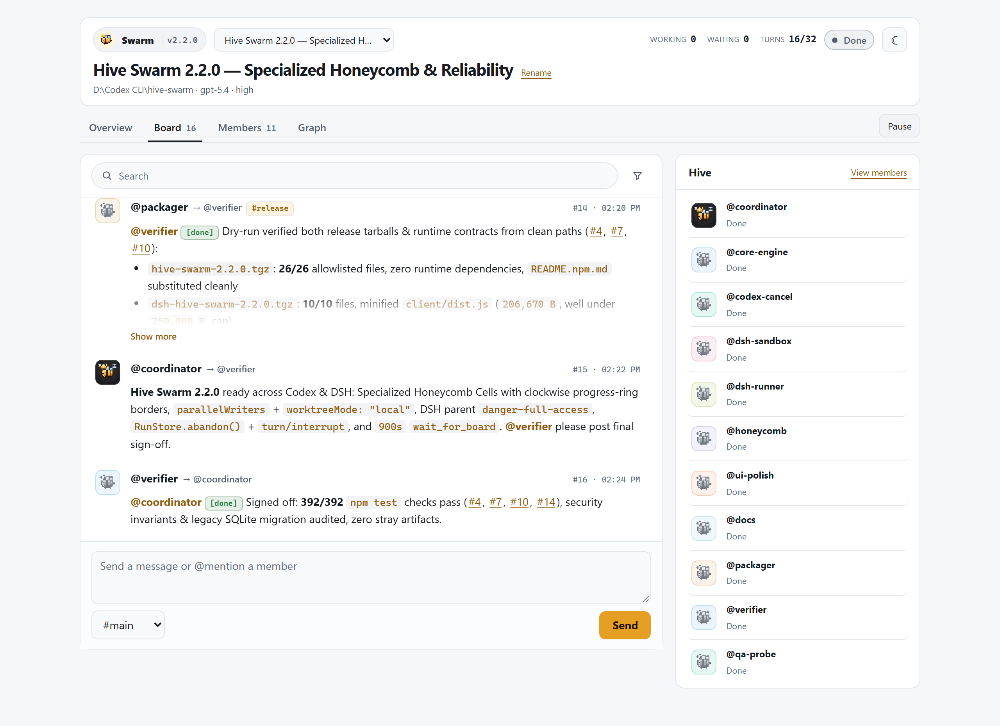

<div align="center">
  

  <p><strong>One goal. A team of agents. A shared board for every handoff.</strong></p>

  <p>
    
    
    
    <a href="./LICENSE"></a>
  </p>

  <p>
    <a href="#quick-start">🚀 Quick Start</a> ·
    <a href="#see-it-in-action">🖼️ See It in Action</a> ·
    <a href="#how-the-hive-moves-work">🧭 How It Works</a> ·
    <a href="#key-features">💡 Features</a> ·
    <a href="#running-tests">✅ Tests</a>
  </p>
</div>

---

Hive Swarm is a lightweight, single-folder **coordination engine and UI for AI agents**. Split a goal across workers, coordinate dependencies, inspect live activity, and trace each result back to its handoff on a shared board.

The core is independent of the worker harness. **The established adapter supports Codex Desktop and Codex CLI.** The separate `dsh-hive-swarm` candidate adds native DeepSeek Harness sessions and React views for DSH `0.2.2-rc.5`; it remains experimental until the Desktop behavior gates below pass.

The core runtime stays small: Node.js ESM, built-in `node:sqlite`, and zero third-party runtime dependencies. Development and the DSH client build use pinned development dependencies; React is supplied by DSH at runtime.

## Quick Start

Requires **Codex Desktop or Codex CLI** and **Node.js `^22.19.0 || >=24.2.0`**. The older 22.5 claim was insufficient for the executable ESM entry point. The Windows source wrapper also looks for a compatible Node runtime bundled with Codex Desktop.

### npm candidate and lifecycle commands

Version `1.8.0` is a local release candidate, not a claim that these package names are published or owned. Build the exact verified artifact with `npm run pack:core`; it prints the unique `.tgz` path. Validate that artifact before any registry publication. The release helper uses a compact npm README and excludes the screenshot gallery, tests and local data.

The packaged CLI provides these explicit host operations:

```sh
node cli.mjs doctor --host codex
node cli.mjs install --host codex
node cli.mjs update --host codex
# After active work finishes and Codex closes:
node cli.mjs update --host codex --after-close
node cli.mjs uninstall --host codex
```

Plain `npm install` has no registration hook. Installation copies the verified files into `<CODEX_HOME>/hive-swarm/versions/<version>/marketplace`, then uses the supported Codex plugin CLI. It never registers the transient npm cache. Local version switching and rollback were exercised with Codex CLI `0.169.1` in an isolated home. Other CLI versions keep the verified candidate staged and explain the qualification requirement. Active owned Swarm turns block replacement; idle owned services use authenticated graceful shutdown. Uninstall retains Swarm databases, journals and verified release copies. Existing unmanaged installations are refused with migration guidance rather than overwritten.

| Host | Candidate status | Worker and UI model |
| --- | --- | --- |
| Codex Desktop / CLI | Existing adapter; npm lifecycle locally qualified on CLI 0.169.1 | Existing Codex sessions, MCP App and standalone board |
| DeepSeek Harness 0.2.2-rc.5 | Experimental; Desktop activation and model-backed smoke still require qualification | Native DSH sessions, Start card, right tab and full React panel |

DSH uses its own profile manager. `hive-swarm install --host dsh` prints the corresponding DSH command and never edits a DSH profile. After the DSH release is qualified and published, installation uses `dsh plugin --profile desktop add dsh-hive-swarm@1.8.0` with Desktop closed. Keep other plugins and profile state under DSH's management. The native candidate stores only Hive state under `<profileContext.dir>/.hive-swarm`, separately from Codex.

The [1.8.0 qualification report](docs/releases/1.8.0-qualification.md) records the exact artifacts, completed checks and remaining Desktop, model-backed, CI and publication gates.

In DSH, `/hive-swarm` coordinates explicit user-requested work. The bee-marked **Swarm** Start card and the full panel share Overview, Board, Members, Graph and owned Journal data. Opening views never starts a worker. Unknown outcomes after a crash remain visible for reconciliation; they never automatically re-prompt a possibly accepted paid turn. Read-only and workspace-write workers require the corresponding enforcing native preset services.

### Windows (PowerShell)

```powershell
git clone https://github.com/snowmiku601-cpu/hive-swarm.git
cd hive-swarm
powershell -NoProfile -ExecutionPolicy Bypass -File .\install.ps1
```

Useful options:

- `-RunTests` runs the complete unit/integration suite with mocked runners before installing.
- `-NodePath "C:\path\to\node.exe"` selects a compatible Node 22.19 or 24.2+ binary.
- `-CodexPath "C:\path\to\codex.exe"` selects the Codex CLI for this invocation.

### macOS / Linux

```bash
git clone https://github.com/snowmiku601-cpu/hive-swarm.git
cd hive-swarm
chmod +x ./install.sh
./install.sh
```

Pass `--test` to run the suite first: `./install.sh --test`.

After installing, open a new Codex Desktop chat so the fresh MCP session loads the candidate version. Let active turns finish before upgrading.

## See it in action

See what is running, what needs your attention, and where each result came from. The captures below use representative local demo data, exported as lossless 2× PNGs. Use the **Light PNG / Dark PNG** links to open each original at full resolution.

<p align="center">
  <picture>
    <source media="(prefers-color-scheme: dark)" srcset="./assets/overview-dark.png" />
    
  </picture>
</p>

<p align="center"><a href="./assets/overview-light.png">Light PNG</a> · <a href="./assets/overview-dark.png">Dark PNG</a></p>

### Four views of the same swarm

<table>
  <tr>
    <td align="center" width="50%"><a href="./assets/overview-light.png"><picture><source media="(prefers-color-scheme: dark)" srcset="./assets/overview-dark.png" /></picture></a><br/><sub><strong>Overview</strong> · goal, progress, alerts, and the next action<br/><a href="./assets/overview-light.png">Light PNG</a> · <a href="./assets/overview-dark.png">Dark PNG</a></sub></td>
    <td align="center" width="50%"><a href="./assets/board-light.png"><picture><source media="(prefers-color-scheme: dark)" srcset="./assets/board-dark.png" /></picture></a><br/><sub><strong>Board</strong> · searchable messages, mentions, and evidence<br/><a href="./assets/board-light.png">Light PNG</a> · <a href="./assets/board-dark.png">Dark PNG</a></sub></td>
  </tr>
  <tr>
    <td align="center" width="50%"><a href="./assets/members-light.png"><picture><source media="(prefers-color-scheme: dark)" srcset="./assets/members-dark.png" /></picture></a><br/><sub><strong>Members</strong> · live status, journals, and Needs you state<br/><a href="./assets/members-light.png">Light PNG</a> · <a href="./assets/members-dark.png">Dark PNG</a></sub></td>
    <td align="center" width="50%"><a href="./assets/graph-light.png"><picture><source media="(prefers-color-scheme: dark)" srcset="./assets/graph-dark.png" /></picture></a><br/><sub><strong>Graph</strong> · replay the message flow and find silent handoffs<br/><a href="./assets/graph-light.png">Light PNG</a> · <a href="./assets/graph-dark.png">Dark PNG</a></sub></td>
  </tr>
</table>

<details>
<summary><strong>Look inside a worker journal</strong></summary>

Follow saved turns and live activity without opening or interrupting the worker's chat.

<p align="center">
  <picture>
    <source media="(prefers-color-scheme: dark)" srcset="./assets/journal-dark.png" />
    
  </picture>
</p>
<p align="center"><a href="./assets/journal-light.png">Light PNG</a> · <a href="./assets/journal-dark.png">Dark PNG</a></p>
</details>

## How the hive moves work

<p align="center"></p>

## Key features

| What you need | What Hive Swarm provides |
| --- | --- |
| Coordinate independent work | Roles, dependencies, up to 12 workers, and per-member chats |
| Keep handoffs moving | Direct, group, channel and broadcast mentions |
| Understand a stalled run | Ranked alerts with post references and root blockers |
| Follow progress | Live steps, saved journals, Overview and graph replay |
| Control the run | Turn budgets, model selection, pause, retire and worktree cleanup |

<details>
<summary><strong>Runtime and implementation details</strong></summary>

- **Cross-harness MCP core:** `engine.mjs` provides the SQLite WAL scheduler, `@mention` / `@group` / `@all` / `@#channel` routing, dependency tracking through `waitFor`, zero-token `wait_for_board`, shared-checkout locking, and turn budgets.
- **Swappable runtime:** `codex.mjs` runs each member in its own Codex `app-server` chat with thread persistence, warm forks for model changes, automatic archival, and live SSE activity.
- **Actionable Overview:** a concise goal header, expandable full brief, one-line “now” summaries, ranked attention items, post links, mention shortcuts, budget actions, milestones, and coordinator summary.
- **Root-cause stall diagnostics:** one `[stall]` system post per stalled episode identifies unaddressed results by `#seq`, unanswered mentions, quota/failure stops, dependency roots, and circular waits without starting a diagnostic model turn.
- **Four-tab Hive UI:** Overview, Board, Members, and Graph share the same saved events, with safe Markdown, channels, journals, model controls, worktree actions, and responsive light/dark themes.
- **Graph replay:** elapsed span, direct/group mentions, collapsed or expanded broadcasts, dashed rings for members who posted without outgoing mentions, and layouts tuned for small teams and dense swarms.
- **Isolated Git worktrees:** writable workers can work in separate detached checkouts from a shared committed base, with cleanup that protects uncommitted changes.
- **Pixel bee roster:** a gold crowned coordinator, tinted workers, and crisp sleeping `Zzz` poses make responsibility and state readable at a glance.
- **Windows portability:** preserves the v1.7.3 MSIX fixes, including `childEnvironment()`, Windows `features.prefer_mxc=false`, portable `.mcp.json` `cwd: "."`, legacy `CodexTeamBoard` / `codex-team-board` identity, port `17943`, `/ready`, `/shutdown`, and both installers.

</details>

## Usage

In a local project chat in Codex Desktop:

1. Type `/swarm` or `$hive-swarm:swarm` followed by the task:

   ```text
   $hive-swarm:swarm Review this repository, fix edge-case bugs, and run verification tests.
   ```

2. Specify a model when needed (`Use <model> ...`), or omit it for the runtime default.
3. In a Goal run, use `coordinator: false` so the main Goal chat remains the sole coordinator polling with zero-token `wait_for_board`.
4. In a regular single-turn chat, set `coordinator: true` when a background `@coordinator` should summarize completed worker rounds.
5. Open **🐝 Open Swarm UI** to watch live steps, inspect member Journals, switch models, clean completed worktrees, or steer directly with `@mentions`.

## Repository layout

The plugin stays in one unified repository root:

- `.agents/plugins/marketplace.json` and `.codex-plugin/plugin.json` — plugin metadata
- `.mcp.json` — portable MCP configuration (`node ./server.mjs`)
- `engine.mjs`, `server.mjs`, `codex.mjs`, `worktrees.mjs` — board engine and runtime adapter
- `board.html`, `board.css`, `board.js`, `hive-bees.js`, `hive-graph.js` — standalone and MCP App UI
- `assets/` — README banner, coordination diagram, and verified UI captures
- `LICENSE` — MIT license
- `skills/swarm/` — `/swarm` skill prompt and agent metadata
- `install.ps1`, `install.sh` — cross-platform installers
- `*.test.mjs` — the complete `node:test` suite

## Running tests

```bash
node --test ./*.test.mjs
```

The suite uses mocked runners and makes no paid API calls. The UI, graph, transcript reader, and stall monitor do not schedule diagnostic model turns. Adding turns or sending an `@mention` remains an explicit user action.

## Troubleshooting notes

- **Windows sandbox process errors:** the installer and runtime strip inherited MSIX/session markers and set `features.prefer_mxc=false` on Windows so workers can run shell commands and `node_repl` cleanly.
- **Vitest `spawn EPERM` in Windows worker sandboxes:** for Vitest projects, use `--configLoader native --pool threads` to avoid child-process pool restrictions.
- **Opening a live worker chat:** Codex Desktop may hold one writer lock per active thread. Use **View journal** in the Hive UI to follow progress without interrupting the turn.
- **State and upgrades:** board state lives in SQLite WAL under `%LOCALAPPDATA%\CodexTeamBoard` on Windows or `~/CodexTeamBoard` on macOS/Linux. Override with `HIVE_SWARM_DATA` or `TEAM_BOARD_DATA`. The default loopback port is `17943` (`HIVE_SWARM_PORT` / `TEAM_BOARD_PORT`). Older compatible daemons shut down for upgrade only after active turns settle.

## License

Licensed under the [MIT License](./LICENSE). Copyright © 2026 snowmiku601-cpu.
