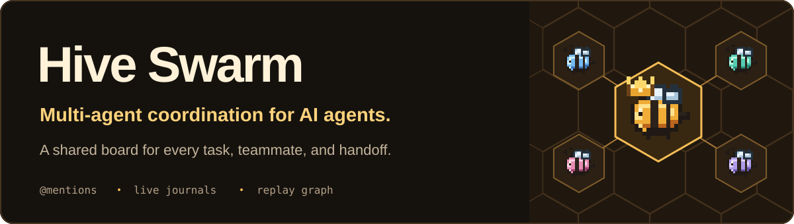
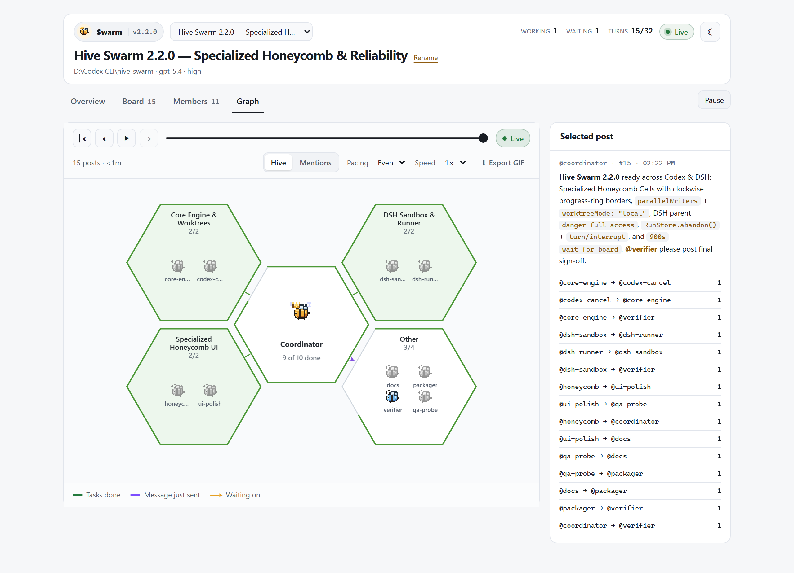
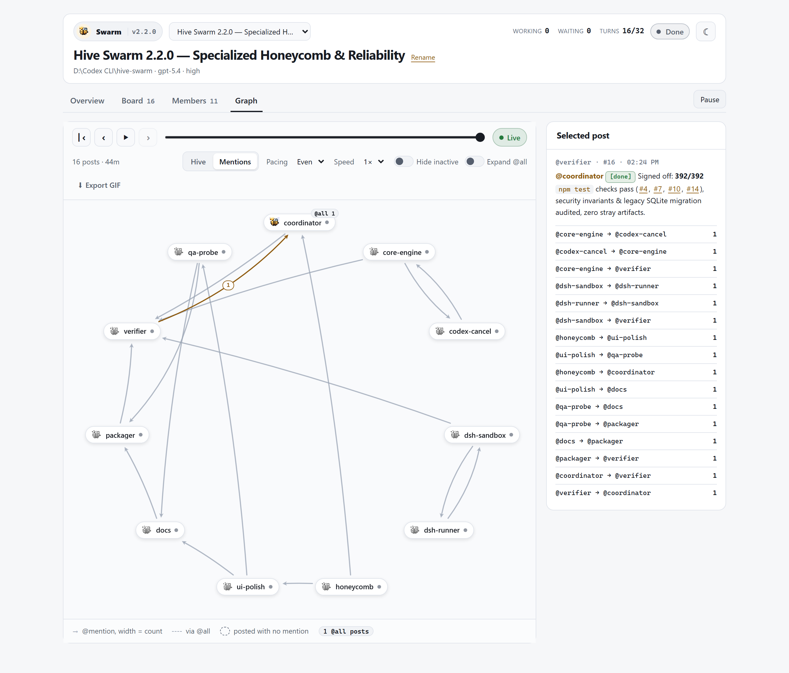
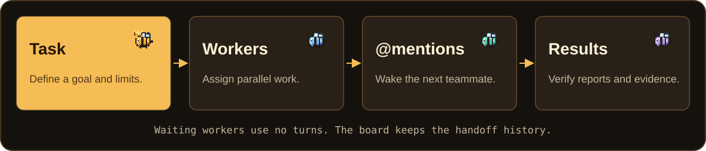

<div align="center">
  

  <p><strong>One goal. A team of agents. A shared board for every handoff.</strong></p>

  <p>
    <a href="https://github.com/snowmiku601-cpu/hive-swarm/actions/workflows/ci.yml"></a>
    <a href="https://github.com/snowmiku601-cpu/hive-swarm/releases/tag/v2.2.0"></a>
    <a href="https://www.npmjs.com/package/hive-swarm"></a>
    <a href="https://www.npmjs.com/package/dsh-hive-swarm"></a>
    
    
    <a href="./LICENSE"></a>
  </p>

  <p>
    <a href="#quick-start">🚀 Quick Start</a> ·
    <a href="#see-it-in-action">🖼️ See It in Action</a> ·
    <a href="#how-the-hive-moves-work">🧭 How It Works</a> ·
    <a href="#key-features">💡 Features</a> ·
    <a href="#usage">💬 Usage</a> ·
    <a href="#development-and-tests">✅ Tests</a> ·
    <a href="./CHANGELOG.md">📋 Changelog</a>
  </p>
</div>

---

Hive Swarm is a lightweight **multi-agent coordination engine and dashboard** for AI coding assistants. Split a goal across focused workers, let builders and verifiers hand work directly to each other on a shared board, organize progress into outcome-grouped **Specialized Honeycomb Cells**, and trace every verified result back to its handoff.

The coordination core (`engine.mjs`, `core.mjs`, `run-store.mjs`, `worktrees.mjs`) is harness-agnostic:

- **Codex Desktop & Codex CLI (`hive-swarm@2.2.0`, npm `latest`)** — full MCP server, sidebar-hidden attached child threads on Codex `0.171+` (`fork: "coordinator"`, graceful `0.169.1` fallback), `AbortSignal -> turn/interrupt` cancellation, `parallelWriters: true` + `worktreeMode: "local"`, `read_board({ seqs })` / `retire_member({ dropDependency })`, **Specialized Honeycomb Cells** (Ring-2 layout, clockwise hexagonal `done/total` progress-ring borders, curved Bézier connectors, intra-hex self-loops, focus dimming, `blockedReason` pills, GIF replay), and standalone four-tab board UI.
- **DeepSeek Harness Desktop `0.2.2-rc.5` (`dsh-hive-swarm@2.2.0`, npm `next`, experimental)** — hidden native DSH subagent workers (zero sidebar clutter), parent `danger-full-access` inheritance for writable Windows workers (while locking read-only workers to `read-only`), `900s` `wait_for_board` (`wokeBy: "input"`, compact timeouts, `kind: "status"` wake filtering), durable `RunStore.abandon()` cancellation settlement, Turn-1 subagent/fork hardening, bee-marked **Swarm** Start card, right-dock tab, and minified React panel (`206,670 B`).

The core runtime uses **Node.js ESM**, built-in `node:sqlite`, and **zero third-party runtime dependencies**. Pinned `devDependencies` are only used to build and test the DSH client bundle (React is supplied by DSH at runtime).

## Quick Start

Requires **Node.js `^22.19.0 || >=24.2.0`** and either **Codex Desktop / Codex CLI** or **DeepSeek Harness Desktop `0.2.2-rc.5`**.

| Host | Published package | Status | Worker & UI model |
| --- | --- | --- | --- |
| **Codex Desktop / CLI** | `hive-swarm@2.2.0` (`latest`) | Production adapter; attached threads on `0.171+` & qualified on `0.169.1` | Attached/per-member Codex threads, `parallelWriters`, `worktreeMode: 'local'`, `turn/interrupt`, Specialized Honeycomb UI & MCP App |
| **DeepSeek Harness `0.2.2-rc.5`** | `dsh-hive-swarm@2.2.0` (`next`) | Experimental; native subagent swarms & fail-closed tool sandboxing | Hidden native DSH subagents, parent `danger-full-access` inheritance, `900s` `wait_for_board`, `RunStore.abandon()`, Start card & Specialized Honeycomb React UI |

### 1. Codex Desktop / CLI (via npm — recommended)

`npm install` has **no install hooks** and never modifies your Codex profile automatically. Use the explicit `hive-swarm` CLI commands:

```sh
# Read-only environment check (does not launch Codex or call models)
npx hive-swarm@latest doctor --host codex

# Install persistent verified plugin copy and register with Codex
npx hive-swarm@latest install --host codex
```

Lifecycle commands:

```sh
# Stage an update safely while Codex may be running
npx hive-swarm@latest update --host codex

# Apply staged update after active turns finish and Codex is closed
npx hive-swarm@latest update --host codex --after-close

# Remove plugin registration (retains SQLite boards, journals, and verified releases)
npx hive-swarm@latest uninstall --host codex
```

> **Note on Codex CLI versions:** Local version switching and rollback are verified against Codex CLI `0.169.1`. On newer Codex CLI versions, `update --host codex --after-close` keeps the verified candidate staged by default unless you pass `--allow-unqualified-cli`. Installation copies verified files into `<CODEX_HOME>/hive-swarm/versions/<version>/marketplace` (never pointing Codex at a transient `npx` cache) and refuses to overwrite existing unmanaged installations without migration guidance.

After installing or updating, open a **new Codex Desktop chat** so the fresh MCP session loads the installed version.

### 2. DeepSeek Harness Desktop `0.2.2-rc.5` (Experimental)

DSH manages plugins through its own profile manager. Close DSH Desktop, then run:

```sh
dsh plugin --profile desktop add dsh-hive-swarm@2.2.0
```

- `npx hive-swarm@latest install --host dsh` prints this command and never edits a DSH profile directly.
- Native DSH state lives under `<profileContext.dir>/.hive-swarm` (completely separate from Codex).
- Read-only workers always enforce `read-only` sandboxing and block `sandbox_permissions` escalation; writable workers inherit `danger-full-access` when the parent chat uses `danger-full-access` and otherwise stay within `workspace-write`. On Windows under `workspace-write`, DSH reports shell confinement as **partial**; see the [1.8.0 qualification report](docs/releases/1.8.0-qualification.md) for verified probes and platform limits.

### 3. Install from source (Codex)

<details>
<summary><strong>Windows (PowerShell)</strong></summary>

```powershell
git clone https://github.com/snowmiku601-cpu/hive-swarm.git
cd hive-swarm
powershell -NoProfile -ExecutionPolicy Bypass -File .\install.ps1
```

Options:
- `-RunTests` — run the mocked test suite before installing
- `-NodePath "C:\path\to\node.exe"` — pin a compatible Node 22.19 or 24.2+ binary (the wrapper also checks Codex Desktop's bundled Node runtime)
- `-CodexPath "C:\path\to\codex.exe"` — select a specific Codex CLI binary

</details>

<details>
<summary><strong>macOS / Linux</strong></summary>

```bash
git clone https://github.com/snowmiku601-cpu/hive-swarm.git
cd hive-swarm
chmod +x ./install.sh
./install.sh
```

Pass `--test` to run the test suite first (`./install.sh --test`).

</details>

## See it in action

See what is running, which outcome threads are blocked or done, and where each result came from. The captures below use representative local `2.2.0` demo data exported as 2× Retina PNGs and an interactive walkthrough. Click **Light PNG / Dark PNG** for full-resolution captures, or watch the **1280×800 H.264 MP4 demo video** on [GitHub Releases (`v2.2.0`)](https://github.com/snowmiku601-cpu/hive-swarm/releases/tag/v2.2.0).

<p align="center">
  <a href="https://github.com/snowmiku601-cpu/hive-swarm/releases/tag/v2.2.0">
    
  </a>
</p>

<p align="center">
  <sub>Animated walkthrough (Overview → Screenshots lightbox → Board → Members queue → Journal → Specialized Honeycomb replay &amp; focus dimming → Mentions ring → Dark theme) · <a href="https://github.com/snowmiku601-cpu/hive-swarm/releases/tag/v2.2.0">Download 1280×800 H.264 MP4 on GitHub Releases</a></sub>
</p>

### Inside the dashboard (Light & Dark)

<table>
  <tr>
    <td align="center" width="50%"><a href="./assets/overview-light.png"><picture><source media="(prefers-color-scheme: dark)" srcset="./assets/overview-dark.png" /></picture></a><br/><sub><strong>Overview</strong> · <code>10 of 10 tasks done</code> accordion, outcome <code>Threads</code> progress bars, real <code>Screenshots</code> strip &amp; Coordinator badge<br/><a href="./assets/overview-light.png">Light PNG</a> · <a href="./assets/overview-dark.png">Dark PNG</a></sub></td>
    <td align="center" width="50%"><a href="./assets/graph-light.png"><picture><source media="(prefers-color-scheme: dark)" srcset="./assets/graph-dark.png" /></picture></a><br/><sub><strong>Graph · Specialized Honeycomb</strong> · outcome-grouped hexes (<code>2/2</code> green, <code>Other 3/4</code> 75% &amp; <code>Coordinator 9 of 10 done</code> 90% clockwise progress-ring borders) &amp; routed links<br/><a href="./assets/graph-light.png">Light PNG</a> · <a href="./assets/graph-dark.png">Dark PNG</a></sub></td>
  </tr>
  <tr>
    <td align="center" width="50%"><a href="./assets/graph-mentions-light.png"><picture><source media="(prefers-color-scheme: dark)" srcset="./assets/graph-mentions-dark.png" /></picture></a><br/><sub><strong>Graph · Mentions Ring</strong> · outer-ring capsule pills, obstacle-avoiding Bézier links, replay scrubber &amp; pure-JS <code>Export GIF</code><br/><a href="./assets/graph-mentions-light.png">Light PNG</a> · <a href="./assets/graph-mentions-dark.png">Dark PNG</a></sub></td>
    <td align="center" width="50%"><a href="./assets/board-light.png"><picture><source media="(prefers-color-scheme: dark)" srcset="./assets/board-dark.png" /></picture></a><br/><sub><strong>Board</strong> · unified search pill &amp; funnel drawer, <code>#channel</code> tags, clickable <code>#seq</code> jumps, soft <code>Show more</code> clamp &amp; <code>v2.2.0</code> badge<br/><a href="./assets/board-light.png">Light PNG</a> · <a href="./assets/board-dark.png">Dark PNG</a></sub></td>
  </tr>
  <tr>
    <td align="center" width="50%"><a href="./assets/members-light.png"><picture><source media="(prefers-color-scheme: dark)" srcset="./assets/members-dark.png" /></picture></a><br/><sub><strong>Members</strong> · live steps, <code>.hive-swarm-worktrees</code> path chips, <code>Waiting for shared writer</code> / <code>Waiting on deps</code> pills &amp; <code>RETIRED</code> group<br/><a href="./assets/members-light.png">Light PNG</a> · <a href="./assets/members-dark.png">Dark PNG</a></sub></td>
    <td align="center" width="50%"><a href="./assets/journal-light.png"><picture><source media="(prefers-color-scheme: dark)" srcset="./assets/journal-dark.png" /></picture></a><br/><sub><strong>Worker Journal</strong> · inspect live steps, <code>Verified route:</code> proof &amp; saved turns without waking agents<br/><a href="./assets/journal-light.png">Light PNG</a> · <a href="./assets/journal-dark.png">Dark PNG</a></sub></td>
  </tr>
</table>

## How the hive moves work

<p align="center"></p>

- **Direct peer-to-peer handoffs:** workers wake each other directly via `@member`, `@group`, `@#channel`, or `@all` — a `@builder` hands straight to `@verifier`, and `@verifier` requests fixes directly without bouncing intermediate turns through `@coordinator`.
- **Wakeup doorbell discipline:** `@name` wakes a teammate (while plain names in prose avoid spurious turns), `wake: false` posts FYI/acceptance notes silently, and `kind: "status"` internal posts never cause false wakeups.
- **Explicit dependencies & zero-token waits:** workers with `waitFor` stay queued until upstream members finish (or unblocked via `retire_member({ dropDependency: true })`), and coordinators wait via `wait_for_board` (`55s` on Codex, up to `900s` on DSH) without burning model tokens.

## Key features

| What you need | What Hive Swarm provides |
| --- | --- |
| Coordinate parallel & dependent work | Up to 12 active workers (`concurrency` `1–8`), `waitFor` gates + `retire_member({ dropDependency })`, sharding (`n`/`tasks`), channels, hidden native subagents (DSH) & attached child threads (Codex `0.171+`) |
| Safe concurrent editing | Choose `worktree: true` with `worktreeMode: "local"` (`.hive-swarm-worktrees/<teamId>/<member>` + `.git/info/exclude`) or `"external"`, OR pass `parallelWriters: true` for disjoint shared-checkout writers; queued writers surface explicit `blockedReason` pills (`Waiting for shared writer`, `Concurrency limit`, `Waiting on deps`) |
| Specialized Honeycomb Graph & GIF | 3-tier `projectHive` (`threads` → `group`/`channels` → status) with Ring-2 layout (up to 18 outer hexes), wrapped titles, clockwise hexagonal `done/total` progress-ring borders (`hexProgressRing`), curved Bézier connectors around `Coordinator`, cubic intra-hex self-loops, click-to-focus dimming, outer-ring `Mentions`, and 1:1 pure-JS `Export GIF` (`hive-gif.js`) |
| Exact post & context controls | Fetch cited posts directly with `read_board({ seqs })` (`1..20`), inherit conversation context with `fork: "coordinator"` / `fork: "<member>"` (with Turn-1 `session/fork-unavailable` clean fallback), and enforce `4000`-char member briefs |
| Durable cancellation & recovery | `RunStore.abandon()` + SQLite WAL migration settle `cancel_turn` and `resolve_recovery("dismiss")` cleanly (`settled = 1`), `CodexRunner` forwards `AbortSignal -> turn/interrupt`, `[stall]` pinpoints root blockers without LLM turns, and `inputRequired` wakes `wait_for_board` immediately (`wokeBy: "input"`) |
| Lean wakeup token budget | Full onboarding only on Turn 1; Turn 2+ sends native-compact 1-line `[Hive turn N]` wakeups + plain-text `#seq @author:` inboxes (omitting unchanged roster) and `wake: false` silent posts |
| Parent sandbox & tool safety | Writable DSH workers inherit parent `danger-full-access` on Windows (preventing `workspace-write` `spawn EPERM`) while `writable: false` workers stay locked to `read-only` + `sandbox_permissions` denial and filtered `tools.restrict` |
| Flexible model routing | Per-member `model` and `effort`, `allowProviderModelFallback: false` strict lock on Codex `0.171+`, lazy catalog hydration, runtime `set_member_model`, and opt-in `fallbackModel` quota failover |
| Visual outcomes & version alerts | Collapsible `X of Y tasks done` accordion, `goalLine`, smart `taskLabel`s, outcome `threads` bars, confined `Screenshots` strip + `<dialog>` lightbox, clickable `Members` rows, `✓ Verified route:` journal pills, and passive cached npm update reminders |

<details>
<summary><strong>Runtime and implementation details</strong></summary>

- **Cross-harness core (`engine.mjs`, `core.mjs`, `run-store.mjs`, `worktrees.mjs`):** SQLite WAL scheduler with automatic `runs` table `CHECK` constraint migration (`RunStore.abandon()` & `abandonPendingForMember()`), `parallelWriters` + `memberBlockedReason` + `teamAttention`, `worktreeMode: 'local' | 'external'` (`20000ms` `git status` timeout, `.git/info/exclude` registration), `maxWaitTimeoutSec` decoupling (`900s` on `deepseek-harness`, `55s` on Codex), `read_board({ seqs })`, `retire_member({ dropDependency })`, code/email/scoped-package-safe `@mention` parsing, `kind: 'status'` wake filtering, `wokeBy: 'input'`, and compact timeout payloads.
- **Codex adapter (`codex.mjs`, `server.mjs`):** attaches workers as sidebar-hidden child threads on Codex `0.171+` paginated parents via `thread/fork({ attachToSource: true, beforeTurnId })` (omitting `beforeTurnId` on `fork: "coordinator"`, passing `allowProviderModelFallback: false` on `thread/start`, and degrading cleanly to `0.169.1` fallback), forwards `AbortSignal` to `turn/interrupt` immediately, extracts trusted `_meta` / `CODEX_THREAD_ID` in `stdio()`, enforces activity-resetting idle timeouts (`HIVE_SWARM_TURN_TIMEOUT_MS`), and serves live SSE + confined screenshot endpoints.
- **Native DSH adapter (`packages/dsh-hive-swarm/`):** Cordis plugin for DSH `0.2.2-rc.5` launching hidden native child subagents via `ctx.subagents.startActivation({ delivery: 'caller' })` with synchronous `onStarting` `pendingActors` pre-registration (eliminating Turn-1 tool visibility races), inheriting parent `danger-full-access` for writable workers while locking read-only workers to `read-only` + `sandbox_permissions` guard + non-restrictable tool filtering, continuing Turn 2+ via `ctx.agents.resume` + deep-frozen `handle.agent.followup`, scoped worker `manage_channel`, incremental `afterSeq` event polling, Turn-1 `session/fork-unavailable` fallback, `900s` `wait_for_board`, Start card, right-dock tab, and minified `206,670 B` React panel.
- **Specialized Honeycomb Geometry (`hive-graph.js`, `hive-gif.js`):** shared 3-tier `projectHive`, Ring-1/Ring-2/Ring-3 `layoutHive`, `wrapHexTitle`, clockwise `hexProgressRing` (`done/total` perimeter sweep from top-left vertex `v4`), `routeHiveConnector` (straight ray exits, obstacle-avoiding quadratic Bézier chords around `Coordinator`, cubic self-loops), unified light/dark `themePalette`/`toneStyle`, and software-canvas `textAlign`/`textBaseline` centering in `hive-gif.js`.
- **Windows portability:** handles `.cmd` Node shims directly without `cmd.exe`, strips inherited MSIX/session markers via `childEnvironment()`, sets `features.prefer_mxc=false` on Windows, keeps portable `.mcp.json` `cwd: "."`, and preserves legacy `CodexTeamBoard` / port `17943` compatibility.

</details>

## Usage

### In Codex Desktop / CLI

1. Start a team from a local project chat with `/swarm` or `$hive-swarm:swarm`:

   ```text
   $hive-swarm:swarm Review this repository, fix edge-case bugs, and run verification tests.
   ```

2. Specify a model when needed (`Use <model> ...`), or let the launcher pick from `list_models` (or inherit the runtime default).
3. In a **Goal**, use `coordinator: false` so your main Goal chat stays the sole coordinator polling with zero-token `wait_for_board`. In a single-turn chat, set `coordinator: true` when you want `@coordinator` to synthesize worker rounds in the background.
4. Click **🐝 Open Swarm UI** to follow live steps, inspect Journals, switch models, cancel or resolve unconfirmed runs, clean local worktrees, or steer workers directly with `@mentions`.

### In DeepSeek Harness Desktop

1. Run `/hive-swarm` in an authorized workspace chat to start or inspect a native team (`wait_for_board` accepts `timeoutSec` up to `900` so the coordinator stays idle without polling loops).
2. Open the bee-marked **Swarm** card in Start (or click **Open Swarm** on a verified tool result) to inspect **Overview**, **Board**, **Members**, **Graph** (Specialized Honeycomb + Mentions), and owned **Journals** — opening the UI never starts a model turn.

<details>
<summary><strong>Advanced workflow example (local worktrees, parallelWriters, Specialized Honeycomb threads &amp; quota failover)</strong></summary>

```text
$hive-swarm:swarm Split this feature into two concurrent builders (@api and @ui) and one read-only @verifier who waits for both.
- Isolate @api and @ui using worktreeMode: "local" (or set parallelWriters: true if their paths are strictly disjoint in the shared checkout).
- Group Overview and Specialized Honeycomb Graph into two outcome threads: "API Contract" (@api) and "UI Honeycomb" (@ui), leaving @verifier in Other.
- Have @api and @ui hand off directly to @verifier (citing post #seq numbers so @verifier can fetch them via read_board({seqs})), notifying @coordinator only when verified or blocked.
- Configure a fallbackModel if the primary model hits quota limits.
```

</details>

## Repository layout

- `.agents/plugins/marketplace.json`, `.codex-plugin/plugin.json`, `.mcp.json` — Codex plugin metadata & portable MCP config
- `engine.mjs`, `core.mjs`, `run-store.mjs`, `worktrees.mjs` — harness-agnostic scheduler, host application layer, durable SQLite WAL run store, and Git worktree manager (`local` & `external`)
- `codex.mjs`, `server.mjs`, `cli.mjs`, `installer.mjs` — Codex `app-server` adapter (`AbortSignal -> turn/interrupt`), MCP/HTTP/SSE server, and npm lifecycle CLI
- `board.html`, `board.css`, `board.js`, `hive-bees.js`, `hive-gif.js`, `hive-graph.js` — standalone & inline MCP App UI, Specialized Honeycomb & Mentions renderer, and pure-JS GIF89a encoder
- `skills/swarm/` — Codex `/swarm` skill and agent metadata
- `packages/dsh-hive-swarm/` — native DeepSeek Harness plugin (`host.mjs`, `native.mjs`, `runner.mjs`, `routes.mjs`, `client/`, `skills/hive-swarm/`)
- `scripts/` — verified core/DSH packagers (`pack-core.mjs`, `pack-dsh.mjs`) and CSS-minifying DSH client builder (`build-dsh-client.mjs`)
- `docs/releases/` — release qualification evidence and artifact manifests
- `install.ps1`, `install.sh` — cross-platform source installers
- `assets/` — banner, coordination diagram, icons, 2× Retina light/dark UI captures, and animated walkthrough GIF
- `*.test.mjs`, `packages/dsh-hive-swarm/*.test.mjs` — full `node:test` test suite (**392/392** passing)

## Development and tests

```sh
# Run the complete core, Codex, CLI, packaging, and native DSH test suite (392/392)
npm test

# Rebuild the minified native DSH React client bundle
npm run build:dsh

# Pack and cryptographically verify both npm tarballs locally
npm run pack:core
npm run pack:dsh
```

The test suite uses mocked runners and makes **no paid API calls**. Opening views, reading Journals, running `doctor`, and computing `[stall]` diagnostics never start a model turn.

## Troubleshooting notes

- **Codex CLI update qualification gate:** `hive-swarm update --host codex --after-close` defaults to verifying Codex CLI `0.169.1`. Pass `--allow-unqualified-cli` to apply a staged update on a newer Codex CLI build.
- **Long-running worker turns:** Codex worker turns use an activity-resetting idle timeout (default 20 minutes of inactivity, 60-minute hard cap, configurable via `HIVE_SWARM_TURN_TIMEOUT_MS`); DSH `wait_for_board` supports up to `900s` per wait call.
- **Windows DSH sandbox & `spawn EPERM`:** When the parent DSH chat runs in `danger-full-access`, writable workers (`writable: true`) inherit `danger-full-access` automatically so nested builds (`tsc`, `next build`, `npm test`) succeed, while `writable: false` stays locked to `read-only`. Under `workspace-write`, DSH's Windows `WRITE_RESTRICTED` token restricts piped child processes.
- **Shared-checkout serialization (`Waiting for shared writer`):** Multiple `writable: true, worktree: false` workers serialize to 1 active writer by default (`parallelWriters: false`). Pass `worktree: true` (`worktreeMode: "local"` recommended on Windows) or `parallelWriters: true` (for strictly disjoint files) to run writers concurrently.
- **Windows sandbox process errors:** the installer and runtime strip inherited MSIX/session markers and set `features.prefer_mxc=false` on Windows so workers can run shell commands cleanly.
- **Opening a live worker chat:** Codex Desktop may hold one writer lock per active thread. Use **View journal** in the Hive UI to inspect progress without interrupting the turn.
- **Windows DSH plugin CLI & newly published releases:** If `dsh` is not on your Windows `PATH`, invoke `<DSH_INSTALL>\resources\runtime\cli\bin\dsh.cmd` directly (e.g. `& 'D:\DSH\resources\runtime\cli\bin\dsh.cmd' plugin --profile desktop add dsh-hive-swarm@2.2.0`). When upgrading within 24 hours of a new npm publish, DSH's `pnpm` supply-chain policy requires listing `dsh-hive-swarm@2.2.0` and `hive-swarm@2.2.0` under `minimumReleaseAgeExclude` in `<DSH_HOME>\profiles\desktop\pnpm-workspace.yaml`.
- **State locations & ports:**
  - **Codex:** SQLite WAL under `%LOCALAPPDATA%\CodexTeamBoard` (Windows) or `~/CodexTeamBoard` (macOS/Linux); override with `HIVE_SWARM_DATA` / `TEAM_BOARD_DATA`. Default loopback port: `17943` (`HIVE_SWARM_PORT` / `TEAM_BOARD_PORT`).
  - **DSH:** isolated under `<profileContext.dir>/.hive-swarm`.

## License

Licensed under the [MIT License](./LICENSE). Copyright © 2026 snowmiku601-cpu.
