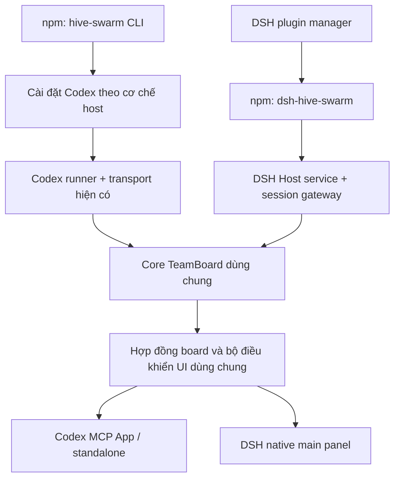

# Thiết kế phát hành npm và tích hợp DeepSeek Harness

**Trạng thái:** ĐỀ XUẤT — chờ người dùng duyệt; chưa cho phép triển khai mã sản phẩm.

**Đã duyệt riêng:** ngày 20/11, người dùng chốt ô **Swarm + icon ong** nằm ngay trên **More tools**, cùng bố cục/căn lề với list gốc DSH. Phần duyệt vị trí này không còn là câu hỏi mở.
**Khởi thảo:** 19 tháng 11 năm 2026; **rà soát:** 20 tháng 11 năm 2026.
**Mốc mã nguồn đã khảo sát:** `7d635e234dbb9d12634ce06b221d978d917e866e` (`main`).
**Swarm khảo sát:** `a9dfb34e-7a1d-45f2-a65a-24be3b098f31`; báo cáo chính #23, #26, #27.
**Hồ sơ sản phẩm:** [PRODUCT.md](../../../PRODUCT.md).

## 1. Điều cần đạt

Người mới có thể cài Hive Swarm theo hướng dẫn ngắn, biết mình đang dùng bản nào và cập nhật/gỡ mà không mất dữ liệu. Người dùng Codex tiếp tục dùng như hiện tại. Người dùng DeepSeek Harness (DSH) có một **ô Swarm kèm icon ong trong danh sách Start bên phải**, mở Swarm native, và các worker chạy bằng session/model của DSH.

Tên sản phẩm, ong chúa, bốn góc nhìn và ý nghĩa các trạng thái nhất quán giữa hai host. Bản DSH dùng giao diện, font, light/dark và cơ chế quyền của DSH; không thay thế shell của DSH hoặc các plugin khác.

Người dùng đã đồng ý hướng phát hành npm và yêu cầu xem bản thiết kế trước khi triển khai. Ngày 20/11, ảnh tham chiếu bổ sung đã chốt yêu cầu ô Swarm/icon ong trong list Start, cùng hàng kiểu Workspace files/Browser/Wallpaper Engine. Các lựa chọn kỹ thuật dưới đây là đề xuất của người thiết kế, chưa phải các chi tiết đã được người dùng duyệt.

## 2. Những gì đã xác minh

| Nội dung | Bằng chứng hiện tại | Hệ quả |
|---|---|---|
| Repo 1.7.4 chưa đóng gói npm | Không có `package.json`/CI; hai installer đang cài local marketplace cho Codex | Cần CLI, kiểm thử gói và quy trình phát hành |
| Core đã có điểm thay runner | `TeamBoard(filename, runTurn)` trong `engine.mjs`; `server.service` hiện chọn `CodexRunner` | Giữ một engine, tách phần phụ thuộc host |
| UI hiện có phụ thuộc Codex | `codex://` trong `board.js`, MCP Apps bridge, trang standalone có `X-Frame-Options: DENY` | Không nhúng iframe rồi gọi đó là bản DSH-native |
| Node minimum hiện chưa đúng | `server.mjs` dùng `import.meta.main`; tính năng này xuất hiện sau Node 22.5 | Sửa phạm vi hỗ trợ, kiểm thử bằng đúng binary tối thiểu |
| DSH cài trên máy là 0.2.2-rc.5 | Metadata executable, manifest trong `app.asar`, `resources/runtime/runtime.json` | Mốc tương thích đầu tiên phải pin rc.5 |
| DSH có panel và session API native | Hợp đồng `main`, `sidebar.panellist`, layout, Session Controller, API Gateway; source Task Board đang cài | Có cơ sở thiết kế native, nhưng Hive vẫn phải vượt qua kiểm thử tích hợp |
| Có UI enhancements thực tế | Task Board 0.4.19, Git Graph 0.4.14, Wallpaper Engine 1.4.3 trong manifest Desktop | Kiểm thử cùng các plugin này; manifest không chứng minh một skin cụ thể đang bật |

Các phép khảo sát không cài/gỡ plugin, sửa cấu hình DSH, đọc hội thoại/credential hoặc gọi model DSH. Một phần kiểm thử read-only của worker bị giới hạn ghi thư mục tạm; không dùng nó làm bằng chứng rằng toàn bộ bản phát hành mới đã pass.

Lưu thêm build identity khi nghiệm thu: manifest Desktop ghi commit `3f85d888b1297107937d9bd5b853f7e733e179a4`, còn tag tài liệu rc.5 trỏ đến mốc upstream riêng. Cùng chuỗi phiên bản không chứng minh hai build giống tuyệt đối; kiểm tra các hợp đồng API quan trọng trên bản cài thực tế trước khi công bố hỗ trợ.

## 3. Các phương án đã cân nhắc

| Phương án | Được gì | Đánh đổi / quyết định đề xuất |
|---|---|---|
| **A. Core chung + tích hợp native riêng cho từng host** | DSH dùng session, model, quyền và panel của chính DSH; Codex giữ đường chạy hiện tại | Chọn làm hướng đề xuất. Cần adapter và kiểm thử tích hợp thực sự |
| B. Runner DSH ngoài tiến trình qua ACP | Có stdio, resume, cancel/close riêng từng session; phù hợp tự động hóa CLI | Chưa chọn làm mặc định desktop: ACP rc.5 thiếu fork/transcript replay và có ranh giới profile khác Desktop |
| C. Mở bảng Codex/standalone trong DSH | Tận dụng giao diện hiện có nhanh hơn | Không đáp ứng mục tiêu worker DSH-native; iframe còn bị chặn. Không dùng làm bản thay thế âm thầm |

Không fork hay vá binary DeepSeek Harness. Không đổi cấu trúc toàn repo chỉ để danh sách tệp ngắn hơn.

## 4. Ranh giới của “đồng bộ”

- Dùng chung engine, hợp đồng dữ liệu, ý nghĩa trạng thái, giới hạn worker/turn và bộ kiểm thử hành vi.
- Giữ cùng phiên bản phát hành cho hai gói cùng đợt; không cho plugin DSH phụ thuộc vào một core phiên bản trôi nổi.
- Giữ bốn view **Overview / Board / Members / Graph**, **Journal**, cảnh báo và hành động tương ứng.
- **Một team thuộc một host.** Bản đầu không trộn worker Codex và DSH trong cùng team, không tự sao chép hội thoại, không nhận việc của app khác làm dữ liệu của mình.
- Codex và DSH có kho trạng thái riêng. “Đồng bộ” ở đây là hành vi/sản phẩm, không phải đồng bộ dữ liệu cá nhân giữa hai ứng dụng.
- Chỉ ánh xạ khả năng đã được host chứng minh. Chức năng chưa hỗ trợ hiển thị lý do rõ; không giả lập kế thừa toàn bộ lịch sử bằng một bản tóm tắt.

## 5. Kiến trúc đề xuất



### 5.1 Hai gói có trách nhiệm rõ

**`hive-swarm`**: core, CLI và phần tích hợp Codex. Giữ zero third-party runtime dependencies cho phần này. Thêm các entry có chủ đích cho engine, hợp đồng board và UI; không yêu cầu người dùng import tệp nội bộ tùy ý.

**`dsh-hive-swarm`**: bundle DSH gồm Host và Client; phụ thuộc đúng phiên bản core tương ứng. Host/client DSH, React và công cụ build tuân theo peer/build conventions của DSH. Không quảng cáo cả hệ sinh thái DSH là zero dependencies.

Hai tên là đề xuất: phải kiểm tra tên, chủ tài khoản và quyền phát hành trước khi publish. Không dùng tài khoản/credential đoán từ máy. Phiên bản ứng viên đề xuất **1.8.0**, chỉ gắn tag khi các gate đạt.

### 5.2 Runtime và lưu trữ

- Codex giữ marketplace/plugin ID, `.mcp.json`, `CodexTeamBoard`, `teams.sqlite`, service key, port 17943 và các bản sửa Windows đã có. Không migrate/xóa dữ liệu chỉ vì cài npm.
- DSH Host plugin tạo một `TeamBoard` riêng trong thư mục dữ liệu plugin do DSH cung cấp; đường dẫn chuẩn hóa, không trỏ vào kho Codex mặc định. Không mở thêm cổng không xác thực.
- Team ghi loại host và bản schema; record cũ không có host được đọc là Codex. Không thay host của một team đã có session.
- Mỗi worker DSH có session do Hive tạo/ghi nhận sở hữu. Lưu mapping team/member/session; mọi thao tác kiểm tra mapping, workspace và lifecycle trước khi gọi host. Không dùng API liệt kê toàn bộ chat để thu thập nội dung không liên quan.
- UI unmount/reload chỉ ngắt subscription. Pause ngừng lên lịch lượt mới, không tự hủy lượt đang chạy. Gỡ plugin/app shutdown phải đóng các subscription và ổn định những lượt Hive sở hữu; không tác động session của plugin khác.

### 5.3 Bộ chạy DSH-native — hướng chính

**Quyết định đề xuất dứt khoát:** Host adapter dùng Session Controller qua API Gateway hiện có trong **cùng tiến trình Desktop DSH**, như cơ chế đã thấy ở Task Board: tạo/resume session, model catalog/selection, prompt, follow/events và cancel. Worker là session DSH bình thường do Hive tạo, nhìn thấy/mở được trong UI DSH; không phải session nằm trong ACP profile riêng. ACP không phải fallback của bản desktop đầu tiên. Dùng kiểu/API pin theo rc.5; không sao chép nguyên triển khai Task Board.

Hợp đồng chung cần chuẩn hóa: chạy một lượt với `team`, `member`, `remember`, `declaredOutcome`, `onActivity`; đọc model catalog; đọc Journal; hủy và dispose những hoạt động thuộc adapter. Kết quả lượt vẫn theo `state/message/notify/waitFor` như engine hiện tại.

- Tạo session mới chỉ cho công việc đã được người dùng cho phép; gắn workspace, preset và quyền trước prompt đầu tiên.
- `writable:false` phải thực sự giữ read-only; worker được ghi chỉ ở workspace/worktree đã cấp. Không đổi mặc định permission toàn host, không tự xác nhận quyền vượt phạm vi. Nếu host không chứng minh được ràng buộc tương ứng, chặn launch và báo lý do.
- Khi worker gọi board tool, lấy danh tính từ execution/session đang chạy, không nhận `member` hoặc principal do model tự khai. Quyền roster/channel giữ tương đương engine hiện có.
- Model/effort lấy từ catalog được DSH công bố; credential vẫn do DSH quản lý. Không tự rơi về model khác khi lựa chọn không khả dụng.
- Prompt acceptance chỉ là nhận việc, chưa phải completed. Kết thúc lượt cần mốc activity của chính prompt đã gửi, journal có thứ tự và trạng thái host đã settle; không dùng timeout quan sát làm bằng chứng công việc đã dừng.
- Trước prompt, ghi một `requestId` bền vững gắn team/member/turn; retry dùng lại ID đó. Theo dõi durable user source tương ứng, mốc claim/turn và report của đúng lượt. Không lấy một trạng thái idle hoặc `[done]` của lượt trước để kết thúc lượt mới. Nếu kết quả admission chưa rõ, đọc lại theo identity trước khi gửi tiếp.
- Fork/resume/đổi model phải kiểm thử riêng. Chỉ bật các capability đã pass trên rc.5; không dùng ACP để âm thầm bù một phần chức năng trong desktop.
- Journal chỉ trình bày step/report cần cho Hive; tránh đưa raw tool arguments, prompt bí mật hoặc token vào board. Reconnect không tạo prompt/lượt tính phí trùng.
- Bổ sung seam cancellation có `AbortSignal`/callback rõ giữa engine và runner trước khi đưa hành động Stop ra UI; engine hiện chưa có đường cancel như vậy. Late completion sau cancel/dispose không được ghi đè lượt mới hoặc đánh thức worker ngoài ý muốn.

**Settlement và recovery bắt buộc:** DSH worker kết luận bằng scoped `set_turn_outcome` cho đúng turn; Host giữ outcome ở dạng pending trước khi scheduler phát thông báo hoặc wake worker khác. Chỉ commit settlement khi quan sát được durable `turn/end` của lượt đã claim đúng prompt identity, host activity của lượt đó đã quiescent và không có thao tác ngoài Hive chen vào interval. Không dùng riêng idle, một câu `[done]`, hoặc việc receipt đã được nhận. DSH API/type adapter phải chứng minh ánh xạ request receipt → durable user source/claim → turn/end trên build thực; nếu không ánh xạ được thì chưa qua G3.

Record gồm run identity, receipt/claim cursor, pending outcome và settled marker. Commit settlement/journal/outgoing wakeups cục bộ là idempotent theo `(team, member, turn)` và bền vững trước khi phát sự kiện. Sau crash: đọc-only đối chiếu đúng session/identity; có outcome + terminal evidence thì hoàn tất settlement đúng một lần; host vẫn chạy thì chỉ observe; bằng chứng thiếu/mâu thuẫn thì chuyển **Needs you — outcome unconfirmed**. Không tự gửi lại prompt, tạo session thay thế hay chạy lại một lượt trả phí. Codex giữ chính sách restore hiện có cho record Codex; việc thêm reconciliation DSH không đổi nghĩa các record cũ.

**Quyền và lifecycle:** chỉ điều khiển session có mapping Hive được ghi nhận ngay khi tạo; không “adopt” một chat sẵn có bằng ID do browser/model nhập. Mặc định team mới read-only. `writable:false` cần policy read-only thực sự của host; `writable:true` cần workspace/worktree-bound write policy và phạm vi người dùng đã cấp. Không suy ra rằng preset auto-approve có sandbox tương đương; nếu không có policy đáp ứng thì từ chối launch. Yêu cầu nâng quyền phải đi qua UI permission của DSH và đưa team về trạng thái cần người dùng; worker không tự cấp quyền, Host adapter không tự trả lời allow cho yêu cầu vượt scope.

Khi plugin unload/update/shutdown: chặn dispatch mới, cancel các prompt Hive đang sở hữu, chờ quiescence theo lifecycle host, ghi trạng thái và đóng subscriptions/DB. Nếu shutdown bị cắt trước khi xác minh terminal thì lưu/khôi phục như outcome unconfirmed, không khẳng định đã cancel thành công. Session không thuộc Hive không bị cancel/archive/delete. Uninstall giữ session history và DB mặc định. Nếu người dùng gửi việc trực tiếp vào worker session trong lúc Hive quản lý, phát hiện admission ngoài run identity và yêu cầu điều phối lại; không nhận kết quả đó làm report của lượt Hive.

**Gate kỹ thuật trước tiên:** kiểm chứng native session API, prompt/settlement correlation, permission scoping và ownership bằng fake services cùng no-model host fixture. Nếu public contract không đủ để làm an toàn, dừng nhánh native để cập nhật thiết kế; không hạ mục tiêu xuống “chỉ tương thích MCP”.

### 5.4 Transport UI DSH

**Hợp đồng đã tìm được trong source rc.5:** Host đăng ký bằng `ctx.connection.fetch.register(ConnectionFetchRoute)`; Client dùng Fetch carrier của Connection. Registry này tồn tại cả khi không có Web server; Electron dispatch shared Fetch qua IPC. Mỗi route có `path`, `methods`, `requestBody` và `fetch(Request): Promise<Response>`, disposer thuộc Context. Không đăng ký route HTTP đơn thuần rồi giả định nó chạy dưới `file://` Desktop.

Chọn ba **exact routes**: `GET /api/hive-swarm/v1/snapshot`, `POST /api/hive-swarm/v1/command`, `GET /api/hive-swarm/v1/events`. Query/body có schema và action allowlist; team ID không nằm trong một wildcard route. Command body giới hạn 128 KiB như server hiện tại; event response là Fetch stream có cursor và `request.signal`. Đây là transport của **panel native**, không phải iframe hay trình duyệt gọi cổng Swarm độc lập.

Gateway tiếp tục phục vụ các thao tác session trên Host, còn Hive không phải tự thêm một namespace Remote có pipeline generation/mount riêng. Public Connection exports `HostConnectionFetch`/`ConnectionFetchRoute`; source `rpc-host.ts` xác nhận exact route từ chối non-owner Peer trước khi gọi handler. HTTP carrier thực hiện admission/Host/Origin; Desktop carrier cung cấp Peer của chính nó. Không gọi trực tiếp shared Fetch handler với một Peer do request tự khai. Live qualification vẫn bắt buộc để xác minh transport của build Desktop đang cài.

- Chỉ owner trong active Host/profile dùng được ba routes ở bản đầu; non-owner bị Connection trả 403. Mỗi command tiếp tục kiểm tra team nằm trong kho của plugin instance và canonical workspace của team thuộc workspace đã cấp; không mặc nhiên dùng workspace đang hiển thị trên browser. Gateway worker calls dùng in-process Peer do Connection tạo/lifecycle quản lý, chỉ sau guard Hive ownership và scope; không lấy principal từ browser.
- Không cho browser gửi owner principal, service secret, tùy ý session ID hoặc tùy ý đường dẫn dữ liệu.
- Mutation có request identity/idempotency; stream có seq/cursor, hủy khi view đóng và đọc bù khi reconnect.
- Thiếu auth service/host capability thì báo unavailable và từ chối thao tác. Không fallback sang anonymous localhost access, `*` CORS hay credential trong URL.
- Nếu rc.5 không cho extension dùng Connection fetch/route admission an toàn, quay lại review transport; chưa phát hành native UI bằng cách mở rộng quyền shell.

### 5.5 Công cụ và điểm vào từ chat

Bundle DSH đăng ký tool native có prefix `hive_swarm_`, với các handler dùng chung cho start/status/post/pause/resume/roster/channel. Parent chat chỉ tạo team theo yêu cầu của người dùng. Tool worker được scope theo session sở hữu và lượt đang active; không công bố một registry toàn quyền cho mọi worker.

DSH có hướng dẫn/điểm vào **`/hive-swarm`** dành riêng cho host, giữ cùng cách chia việc nhưng dùng native panel/session APIs. Chỉ thêm alias `/swarm` nếu không xung đột lệnh/skill đã cài. Không bê nguyên skill Codex chứa `open_in_codex` sang DSH. Khi một Goal/chat hiện tại đang làm coordinator thì không tạo thêm coordinator nền; trạng thái ownership này phải đi vào team lúc tạo.

Empty state chỉ dẫn điểm vào chat và workspace cần chọn; mở panel hoặc xem ví dụ không tự gọi model. Hành động “Open Swarm” từ kết quả tool dùng navigation của DSH và đúng team ID, không dựa vào team gần nhất toàn máy. Giữ nguyên tool/skill namespace và luồng `/swarm` của Codex.

## 6. Trải nghiệm giao diện

### Điểm vào bắt buộc: ô Swarm trong Start

Đây là yêu cầu hình ảnh mới của người dùng, **thuộc bản native đầu tiên**, không phải tùy chọn đợt sau:

- Label **Swarm**, dùng icon ong chúa SVG đang có của Hive, không dùng emoji phụ thuộc font và không nhận icon placeholder hình khối.
- Đăng ký tab type bằng `ctx.sidebarRightTabs.register`: ID riêng của gói `dsh-hive-swarm`, kind `hive-swarm`, title `Swarm`, một phần tử `guide[]` có ID ổn định, title/icon và order. Body đăng ký dưới `sidebar.right.pane.tab` với key là ID definition.
- Dùng **standard guide card renderer** của DSH. Host quyết định capsule, border radius, padding, gap, hàng icon/title, hover/focus và độ rộng cùng list; không tạo một nút absolute theo tọa độ ô đỏ trong ảnh, không chèn DOM vào sau một nút cụ thể.
- Order ứng viên 900, qualify trên cấu hình đang cài để Swarm nằm sau các tool cards hiện có. **Vị trí đã được người dùng duyệt:** **Wallpaper Engine → Swarm → More tools**. rc.5 giữ More tools cuối list; không tạo một ô nằm ngoài list hoặc override toàn bộ guide để đổi quy tắc này.
- Khi bundle npm được cài qua DSH plugin manager và Client entry được activate, registry tự thêm card vào Start. Không yêu cầu người dùng tự sửa profile hay pin một entry bằng tay. Tôn trọng lựa chọn ẩn/pin do host quản lý sau đó.
- Chọn card dùng navigation mặc định của guide: mở tab `hive-swarm` trong chính pane đó, thay Start theo lifecycle host. Tab Swarm dùng native React view responsive, cùng dữ liệu/controller với full panel; người dùng có thể dùng expand/fullscreen/docking của DSH. Không mở cửa sổ trình duyệt ngoài hoặc một trang iframe khác.
- Không có team liên kết thì hiện empty state/selector trong đúng workspace; không tự khởi chạy model, tạo team hay chọn team gần nhất toàn máy. Team liên kết phải đến từ parent session hoặc thao tác chọn rõ ràng của người dùng.
- Enable/reload nhiều lần chỉ có một card; disable/gỡ rút đăng ký của Hive và không làm mất những card khác. Khi tab type/slot chưa có, doctor báo capability thiếu, không gây lỗi toàn shell.

### Full panel bổ sung trong DSH

Thêm một entry **Hive Swarm** kèm icon ong vào `sidebar.panellist` và một keyed page riêng trong `main`; chọn bằng layout API. Entry có ID riêng, đăng ký/dispose theo lifecycle plugin, không ghi đè Task Board. Order 30 là ứng viên, sau Task Board order 20, nhưng giữ cơ chế sắp xếp của host.

Panel chính có cấu trúc dự kiến:

1. Header gọn: Hive Swarm, workspace, team picker, trạng thái và hành động Pause/Resume.
2. Bốn tab hiện có; Overview là điểm vào để thấy mục tiêu, tiến độ và việc cần người dùng.
3. Nội dung đầy đủ của view đang chọn; Members mở Journal và session tương ứng khi host cho phép.
4. Các lỗi kết nối/quyền/model có hành động khắc phục rõ, không chỉ toast biến mất.

Không tự chiếm `conversation.input.dock` (Git Graph đang dùng), không thay composer/chat. Right tab từ card Start và main panel dùng chung một native Swarm view/controller; nút **Open full view** mang theo đúng team/workspace sang main panel. Hai chỗ hiển thị không được tạo hai scheduler hay hai lượt worker cho cùng thao tác. Right tab giữ đúng session context khi đổi chat hoặc đổi workspace.

### Dùng chung và phối hợp theme

- Tách controller/transport của UI hiện tại để mount có scope; Codex MCP bridge và standalone bootstrap vẫn hoạt động.
- Chọn **native React renderer cho DSH**, theo SDK/components của host; Codex giữ renderer hiện tại. Dùng chung view-model/selectors, action contract, state machine, graph projection/layout và dữ liệu sprite ong. Hai renderer phải chạy cùng fixture/parity matrix cho nội dung và hành động; không viết hai engine hoặc ép toàn trang HTML/imperative DOM vào shell DSH.
- DSH theo `--dsw-alias-*`, font và theme đang chọn của host; không có theme toggle cạnh tranh. Codex/standalone giữ preference hiện tại.
- Giữ ong chúa và accent gold ở phạm vi thành phần, không tô lại `body`, không đổi font toàn app hay ép glass/blur.
- Wallpaper/glass phải vẫn đọc được: lớp surface đủ tương phản khi cần, không phủ opaque toàn shell, không đụng layout/animation của wallpaper engine.
- View đầy đủ giữ nguyên tính năng trên màn hẹp bằng xếp một cột/overflow có chủ đích; không thu cả dashboard desktop thành chữ li ti.
- Keyboard/focus/label, focus return của Journal, contrast và reduced motion là tiêu chí nghiệm thu. Các trạng thái: first-run, empty, loading, reconnecting, missing capability, denied permission, unavailable model, quota, stalled, budget và retired.

Đây là đặc tả hành vi và bố cục để duyệt, chưa phải mockup pixel hay thay đổi bộ nhận diện.

Phạm vi phối hợp plugin đợt này là theme/font/surface, navigation, workspace/worktree context và không va chạm thao tác. Không tự biến Task Board card thành một team, đánh dấu card Done hay đồng bộ task hai chiều. Kết nối dữ liệu dạng đó cần một extension contract và quyết định sản phẩm riêng, thay vì suy ra từ việc hai panel cùng nằm trong DSH.

## 7. Cài đặt npm, cập nhật và gỡ

Các lệnh dưới đây là **giao diện đề xuất, chưa tồn tại**:

```sh
npx hive-swarm@latest install --host codex
npx hive-swarm@latest doctor --host codex
npx hive-swarm@latest update --host codex
npx hive-swarm@latest uninstall --host codex

dsh plugin --profile desktop add dsh-hive-swarm@1.8.0
```

- `npm install` thuần chỉ tải gói, không tự sửa cấu hình host qua postinstall.
- CLI Codex tạo bản copy versioned bền vững trong local marketplace; không đăng ký đường dẫn npm/npx cache tạm, không chạy server từ gói đang bị npm thay thế.
- Tái dùng Codex CLI theo host flow đã kiểm chứng: bản CLI 0.169.1 đang cài có `plugin add/remove` và `plugin marketplace add/list/upgrade/remove`. Ưu tiên các entry này hơn gọi app-server API đang thay đổi. `marketplace upgrade` cho Git snapshot không tự chứng minh update local marketplace; qualify add/update/remove/rollback bằng `CODEX_HOME` tạm trước khi hứa cài unattended. Nếu host cần một bước UI, CLI nói rõ và chỉ dẫn bước đó.
- Giữ hai installer hiện có cho người cài từ source. Doctor kiểm tra host/Node, đúng package/runtime version, capability và nơi cài mà không chạy model.
- Update stage/verify trước, không ngắt team đang chạy; có rollback và giữ bản cũ đến khi host reload thành công. Uninstall chỉ gỡ phần Hive sở hữu, giữ DB/journal mặc định.
- Rollback phải có bằng chứng: Codex cài lại bản persistent marketplace đã xác minh qua CLI host trong `CODEX_HOME` tạm; DSH cài lại exact phiên bản trước bằng `dsh plugin --profile desktop add <package>@<previous-version>` khi Desktop đã đóng. So sánh data/journal và dependency/bundle inventory của các plugin khác trước/sau. Không khôi phục bằng cách hand-edit profile/lockfile. Nếu host chưa chứng minh được thao tác rollback thì không quảng cáo update/rollback an toàn; giữ bản stage và hướng dẫn người dùng chờ qualification.
- DSH dùng plugin manager/CLI của DSH để quản lý profile; không tự chỉnh `package.json`, lockfile hay Cordis patch cá nhân bằng npm hoặc script Hive. Desktop cần thoát hẳn theo cơ chế DSH, rồi mở lại để activate; không tự tắt app khi đang có việc.
- Tên npm, tài khoản, xác thực publish và public release là bước người dùng duyệt riêng sau khi đã có gói cụ thể và kết quả kiểm thử. Không cần giao mật khẩu/token cho chat.

## 8. Đóng gói, phiên bản và README

- Core tarball chứa runtime, hidden manifests, skill, CLI, UI và hai icon; không chứa `.git`, test fixtures, ảnh gallery nặng hoặc dữ liệu máy người dùng.
- Gallery hiện chiếm gần 9.84 MB; giữ trên GitHub. README trong npm dùng URL ảnh phù hợp hoặc bản giới thiệu gọn để không có ảnh hỏng.
- DSH tarball có `dsh.bundle.patch`, Cordis layer, Host/Client entry và built outputs; declared peers dùng instance host. npm registry artifact phải chạy được mà không cần monorepo source hay build script lúc cài.
- DSH đầu tiên pin `0.2.2-rc.5`, chỉ mở range sau kiểm thử cohort khác. Các API trên `master` không thay bằng chứng tương thích bản cài.
- Phạm vi Node đề xuất `^22.19.0 || >=24.2.0`; giải thích thay đổi từ claim 22.5 hiện có và thử thật các minimum này. Không chỉ kiểm tra import SQLite.
- Một nguồn phiên bản cho package, Codex manifest, client identity và changelog; CI phát hiện lệch. Tag/release phải khớp gói đã test.
- **Cho phép core/Codex npm phát hành trước DSH** sau khi G1/G2 và gate publish của chính core đạt. Đây không phải tuyên bố hoàn tất mục tiêu DSH: README đánh dấu DSH là planned/experimental, không có badge “supported”. Khi DSH đủ gate thì phát hành riêng, dependency pin đúng core đã qualified và compatibility table ghi exact cặp phiên bản. Nếu cùng release batch thì version hai gói khớp; nếu core đã tiến lên thì không giả vờ hai artifact cùng mốc.
- README ưu tiên cách cài theo host, ảnh và compatibility table; giữ khoảng 4–5 badge hữu ích. Chỉ thêm npm/download/CI badge khi nguồn dữ liệu đó có thật. GitHub Release có release notes và các artifact tương ứng.

## 9. Các phần dự kiến thay đổi sau khi duyệt

| Phạm vi | Tệp/mô-đun dự kiến |
|---|---|
| Phát hành core/CLI | `package.json`, `cli.mjs`, CLI/installer helpers, package verification scripts, CI workflows |
| Lõi và hợp đồng | `engine.mjs`, tách handlers/host contracts khỏi `server.mjs`, giữ `codex.mjs` adapter |
| UI chung | `board.js/html/css`, transport/controller entry, graph/bee helpers chỉ sửa khi cần scope/theme |
| Bundle DSH | `packages/dsh-hive-swarm/` với Host service, native session runner, scoped tools/skill, routes, React Client, manifest/patch và tests |
| Tài liệu | README cài theo host, compatibility, changelog, migration/uninstall và release notes |

Không tự chuyển các tệp hiện có sang `src/`/`tests/` trong cùng đợt nếu không phục vụ các giao diện trên.

## 10. Nghiệm thu và phát hành theo gate

| Gate | Bằng chứng phải có |
|---|---|
| G1 — Codex/npm | Toàn bộ 121 test nền tiếp tục pass, test mới cho CLI/tarball/install lifecycle, MCP executable handshake và resources từ gói thật |
| G2 — Tính di động | CI sạch Windows/macOS/Linux; minimum Node + các LTS được quảng cáo; đường dẫn có khoảng trắng/non-ASCII, quyền truy cập thất bại, rollback, no data loss |
| G3 — DSH Host | Bundle load/dispose rc.5; fake Gateway/session fixtures kiểm chứng create/resume/model/prompt/settle/cancel, reader/writer permissions, ownership, duplicate/reordered events và restart recovery |
| G4 — DSH UI | Card Swarm/icon ong xuất hiện tự động trong native Start list sau activation; đúng padding/width và thứ tự đã duyệt, mở đúng native tab; không duplicate khi reload, gỡ không ảnh hưởng các card khác. Panel/sidebar, auth refusal, stream reconnect, theme/keyboard/dialog; test với Task Board/Git Graph/Wallpaper Engine đã nhận diện và không có các plugin đó |
| G5 — Hành vi thật | Smoke tối thiểu trong DSH Desktop: khởi tạo team, worker gửi kết quả, worker phụ thuộc thức đúng lúc, xem Journal và mở đúng session; cần người dùng đồng ý trước nếu phát sinh lượt model/API |
| G6 — Publish | Exact tarballs, allowlist, version integrity, license, npm owner/name/auth, changelog/tag; quyết định release cuối dựa trên bằng chứng đã lưu |

Không quảng cáo DSH-native chỉ vì bundle cài được, panel render được hoặc fake tests pass. Chưa có G5 thì chỉ gọi là experimental/unqualified; không gọi toàn bộ mục tiêu đã hoàn tất.

Thứ tự thực hiện đề xuất sau khi duyệt: **npm/Codex không hồi quy → proof native DSH Host → panel và compatibility → kiểm thử thật → publish**. Có thể làm các phần độc lập song song bằng Swarm, nhưng phát hành DSH chờ đủ gate và không làm chậm tính đúng đắn của bản Codex đang dùng.

## 11. Các điểm người dùng đang duyệt

1. Hai gói, một engine; bản DSH có mục Hive Swarm native và dùng model/session của DSH.
2. Mỗi team thuộc một host; đợt này không chuyển hội thoại hoặc trộn worker giữa hai app.
3. Có card **Swarm + icon ong** trong Start ngay từ bản đầu, mở native right tab và có full panel; theo theme/font DSH, giữ cùng list renderer với các tool khác. **Đã duyệt vị trí**: **Wallpaper Engine → Swarm → More tools**. Các chi tiết runtime/đóng gói còn lại trong bản thiết kế vẫn chờ duyệt tổng thể.
4. Giữ dữ liệu khi update/uninstall; publish và model-backed smoke cần bước xác nhận cụ thể khi đến nơi.

Các chi tiết triển khai nhỏ còn lại giao cho builder sau khi duyệt. Nếu gate API native thất bại hoặc phải thay đổi một trong bốn điểm trên, quay lại cập nhật thiết kế, không tự giảm phạm vi.

## 12. Nguồn và dấu vết khảo sát

Fresh builder check ở báo cáo #47 nêu 5 câu hỏi. Bản rà soát ngày 20/11 đã chốt: Desktop Gateway in-process (5.3), settlement/recovery theo run identity (5.3), quyền/cleanup (5.3), exact Connection Fetch registry cho HTTP/IPC (5.4), và core có thể phát hành trước với rollback qua host manager (7–8). Những lựa chọn này là quyết định đề xuất của người thiết kế để người dùng duyệt, không phải bằng chứng rằng mã đã được xây dựng.

- Repo hiện tại: `engine.mjs`, `server.mjs`, `codex.mjs`, `board.js`, installers và các plugin manifests tại mốc nêu trên.
- Metadata cục bộ: `D:/DSH/resources/runtime/runtime.json`; package manifests của ba UI enhancements trong profile Desktop. Chỉ dùng metadata/source; không đọc credential hay private chats.
- [DSH rc.5 — Session Controller](https://github.com/deepseek-ai/deepseek-harness/blob/dsh-v0.2.2-rc.5/packages/api/session-controller/README.md).
- [DSH rc.5 — API Gateway](https://github.com/deepseek-ai/deepseek-harness/blob/dsh-v0.2.2-rc.5/docs/api-gateway.md).
- [DSH rc.5 — Connection/auth và Desktop carrier](https://github.com/deepseek-ai/deepseek-harness/blob/dsh-v0.2.2-rc.5/packages/client/connection/README.md), [public Fetch types](https://github.com/deepseek-ai/deepseek-harness/blob/dsh-v0.2.2-rc.5/packages/client/connection/src/rpc.ts), [registry/admission implementation](https://github.com/deepseek-ai/deepseek-harness/blob/dsh-v0.2.2-rc.5/packages/client/connection/src/rpc-host.ts).
- [DSH rc.5 — Layout](https://github.com/deepseek-ai/deepseek-harness/blob/dsh-v0.2.2-rc.5/packages/client/ui-layout/README.md), [Slots](https://github.com/deepseek-ai/deepseek-harness/blob/dsh-v0.2.2-rc.5/docs/subsystems/slots.md), [Right Sidebar](https://github.com/deepseek-ai/deepseek-harness/blob/dsh-v0.2.2-rc.5/docs/subsystems/sidebar-right.md).
- [DSH rc.5 — Start guide cards / More tools](https://github.com/deepseek-ai/deepseek-harness/blob/dsh-v0.2.2-rc.5/packages/client/ui-sidebar-right/README.md#the-guide), [public guide entry/tab registry types](https://github.com/deepseek-ai/deepseek-harness/blob/dsh-v0.2.2-rc.5/packages/client/ui-sidebar-right/src/client/tab-registry.ts). Ảnh người dùng chỉ dùng để xác định vùng UI; không đưa nội dung chat riêng trong ảnh vào repo/artifact phát hành.
- [DSH rc.5 — Plugin publishing/profile ownership](https://github.com/deepseek-ai/deepseek-harness/blob/dsh-v0.2.2-rc.5/docs/user/develop/basic/publish.md), [Desktop launcher](https://github.com/deepseek-ai/deepseek-harness/blob/dsh-v0.2.2-rc.5/apps/desktop/README.md), [ACP limitations](https://github.com/deepseek-ai/deepseek-harness/blob/dsh-v0.2.2-rc.5/packages/acp/acp/README.md).
- Installed Task Board source: `src/client/native-panel.tsx`, `src/host-runner.ts`, `src/host-routes.ts`; đây là tiền lệ để kiểm chứng, không phải mã được sao chép vào Hive.
- [Node ESM/import.meta.main](https://nodejs.org/api/esm.html#importmetamain), [npm package content/bin](https://docs.npmjs.com/cli/v11/configuring-npm/package-json), [GitHub Releases](https://docs.github.com/en/repositories/releasing-projects-on-github/about-releases).
